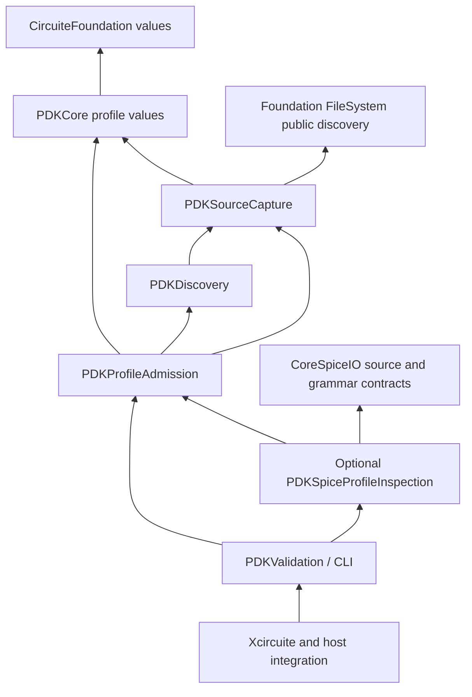

# PDKKit Design

## Purpose and Scope

Canonical process-design-kit discovery, identity and validation contracts.

The package now includes a local deterministic implementation of these
contracts, a retained corpus evaluator, standard-view inspection, immutable
oracle comparison and a local assessment evidence handoff.
The implementation is intentionally manifest-driven: the manifest is the typed
semantic index, while standard-format files remain immutable artifacts whose
bytes are verified by digest and size.
Parent: [LSI](../DESIGN.md). The affected child is
[PDKStandardViews](Sources/PDKStandardViews/DESIGN.md), alongside the independently
buildable [PDKSourceCapture](Sources/PDKSourceCapture/DESIGN.md) admission module.
Manifest validation is owned by [PDKValidation](Sources/PDKValidation/DESIGN.md).
The profile foundation is indexed below. PDKCore profile values and their isolated
test target, checked admission, stage consumption matching and prepared execution-source binding are implemented;
bounded native SPICE/JSON adapters and profile CLI are implemented with macOS
evidence; Engine/host composition is implemented with Native CPU/SQLite evidence.
Each implemented boundary records its behavioral evidence in its owning design.

## Responsibilities and Boundaries

This package owns the schemas and engine protocols listed in its public products. It must remain usable without UI state and without the Xcircuite runtime.

## Non-responsibilities

- Running DRC, LVS, PEX or simulation
- Declaring a tool qualified
- Mutating design data

## Architecture

```text
Swift/Foundation
       ↓
CircuiteFoundation artifact intent, identity and integrity
       ↓
PDKKit protocols and typed result schemas
                 ↓
PDKStandardViews parser-backed implementations
                 ↓
DesignFlowKernel stage execution (injected protocol)
                 ↓
Xcircuite concrete .xcircuite persistence
```

Backends may depend on lower-level data packages. This package must never import `Xcircuite` or `circuit-studio`.

## Contracts and Invariants

Kernel availability, corpus validation, oracle correlation, local evidence
handoff, process-scoped qualification and release approval are distinct states.
The package reports capability and evidence; ToolQualification and Xcircuite
apply process and flow policy.

## Artifact requirements

All outputs are immutable run artifacts with format, digest, producer metadata and the input design/PDK revision needed to reproduce the result.

PDKKit validation emits a `PDKCapabilityReport` plus immutable artifacts and
execution provenance. No local validation result is treated as foundry
qualification; ToolQualification consumes the evidence and owns trust state.

[PDKCore](Sources/PDKCore/DESIGN.md) owns manifest/asset values, identity projections
and asset declaration checks. View composition and status contracts are owned by
[PDKStandardViews](Sources/PDKStandardViews/DESIGN.md) and
[PDKValidation](Sources/PDKValidation/DESIGN.md).

`PDKAssetReference` is the PDK-owned artifact intent. Its
`artifactLocator()` projection uses `CircuiteFoundation.ArtifactLocator`.
`LocalPDKAssetResolver` materializes that intent through
`LocalArtifactReferencer`, producing a streaming SHA-256 and an immutable
`ArtifactReference`. PDK requests and results use CircuiteFoundation artifact
types directly, and each execution protocol refines `Engine` with its domain
request and result types.

Manifest validation and standard-view, rule-deck and oracle admission use
[PDKSourceCapture](Sources/PDKSourceCapture/DESIGN.md). Semantic readers consume
its verified immutable bytes. Canonical `ArtifactReference` values are retained
in standard-view IR, rule-deck payloads and oracle comparison payloads. Earlier
identity discovery remains separate and is not covered by capture budgets.

Corpus and oracle reports retain the selected PDK manifest digest so
ToolQualification can evaluate their scope together with independent process
evidence and human approval.

When a format-specific semantic parser or reference oracle is unavailable,
the validator emits a structured `blocked` result. It does not infer
cross-view correctness from file existence alone.

The corpus evaluator preserves this distinction by treating an expected
blocked case as a passing corpus case only when the declared blocker is
reproduced. This is test evidence, not qualification evidence.

The selected LEF/GDSII/OASIS adapters depend on `swift-mask-data` only in the
`PDKStandardViews` target. LEF physical declarations are retained as the
standard-owned `LEFDocument`, alongside PDK-owned identity, validation and
inventory facts. [StandardInspection](Sources/PDKStandardViews/StandardInspection/DESIGN.md)
owns complete observed layer names, including actual geometry references; engine
source mapping uses this inventory without synthesizing declarations. This replaces the names-only physical projection: duplicating
cell/pin/via/rule fields in a second PDK schema would create another independent
loss boundary. PDKCore and portable domain manifests do not gain this dependency.
SPICE and Liberty retain their existing PDK-owned inspection schemas.

The artifact digest and byte count used by the semantic parser must agree with
the actual in-memory bytes parsed, not only an earlier read of the source path.
Inspection remains distinct from engine capability and process qualification.

## Related Designs

| Design | Relationship | Contract Used | Summary | Cautions |
|---|---|---|---|---|
| [LSI](../DESIGN.md) | Parent | Exact process evidence | Platform composition | Inventory does not establish production closure |
| [PDKCore](Sources/PDKCore/DESIGN.md) | Child | Manifest and asset identity | Declaration checks and resolution | Resolution does not authenticate declarations |
| [PDKDiscovery](Sources/PDKDiscovery/DESIGN.md) | Child | Discovered/exact manifest loading and invocation-bounded candidate/decode entrypoints | Reference-construction owner | Legacy loading does not prove invocation bounds |
| [PDKStandardViews](Sources/PDKStandardViews/DESIGN.md) | Child | Retained standard semantics | Inspection boundary | Unsupported grammar fails explicitly |
| [PDKValidation](Sources/PDKValidation/DESIGN.md) | Child | Manifest and composed validation | Validation results | Admission does not imply qualification |
| [PDKSourceCapture](Sources/PDKSourceCapture/DESIGN.md) | Child | Bounded exact owned parser input | Manifest/view/rule-deck admission | Successful cleanup is part of source admission; captures do not imply a closed PDK graph |
| [PDKProfileAdmission](Sources/PDKProfileAdmission/DESIGN.md) | Child | Checked exact profile admission and stage consumption comparison | Independent host module without Engine codecs | Native format adapters and host adoption remain separate |
| [PDKSpiceProfileInspection](Sources/PDKSpiceProfileInspection/DESIGN.md) | Child | CoreSpice grammar adapter | Optional standalone host product | No CoreSpice-to-PDK reverse dependency |
| [PDKKitCLICore](Sources/PDKKitCLICore/DESIGN.md) | Child | Standalone command composition and scoped output | Bounded profile commands implemented; macOS runtime verified | Actual output delivery is part of completion |
| [PDKDesignDatabaseIntegration](../PDKDesignDatabaseIntegration/DESIGN.md) | Used by | Canonical exact profile/source retention | Host-only schema/runtime | Existing database locks/plans remain authoritative |
| [LEF](../swift-mask-data/Sources/LEF/DESIGN.md) | Depends on | LEFDocument and typed errors | Standard physical schema ownership | Consumers must resolve process names and capability |

## Verification and Change Impact

The package manifest consumes the [CoreSpice host deployment contract](../CoreSpice/DESIGN.md#responsibilities-and-boundaries) through its exact dependency closure. Changes to that contract require resolution and affected host-product verification.

Identity construction is specified by
[PDKDiscovery](Sources/PDKDiscovery/DESIGN.md) and its
[ManifestLoading](Sources/PDKDiscovery/ManifestLoading/DESIGN.md) child, using the
[Core Identity](Sources/PDKCore/Identity/DESIGN.md) contract. Core values, the manifest loader and Xcircuite exact handoff are implemented.
Standard ownership for the completed identity handoff and four PDK products has
verified evidence in the task records. All twelve PDK test products are declared
in the schema-3 workspace inventory, including the profile/CLI/adapter products. Legacy discovery/parser paths do not inherit
the new bounded entry's proof. Exact database locks and canonical PDK persistence
remain owned by the existing system/database integration designs.

PDKStandardViewTests verifies actual inspection, source identity, retained
physical fields, serialization and parser failures. PDK validation/corpus and
external-provider tests verify composition. Physical engines must separately
prove placement, pin access, routing and extraction against the retained view.

For the identity-composition correction, native verification includes the full
106-test package, seven real CLI cases and four real Xcircuite public-API stage
executions with immutable artifact verification and ledger retention. The changed
PDK objects were verified under a temporary consumer override, which was removed.
The large Xcircuite test product did not execute within its build timeouts; this
evidence covers the four API paths, not that complete test product.

## Profile Foundation Specification and Implementation Order

Status: specified foundation and prepared execution sprints are implemented and
verified on Native CPU/SQLite; process qualification remains independent. S1 requiredness/
structural dependency refusal, S3 lower contracts, S4 bounded source/discovery and
S5 checked admission/consumption comparison are implemented with focused Native
evidence. S6 native SPICE/JSON adapters and profile CLI are implemented with
macOS runtime evidence and explicit unsupported-codec/platform refusal. S7 host
adoption and S8 cumulative integration are implemented and verified on Native
CPU/SQLite. Evidence scope follows the actual executed backend and target.
Scope: close requested-requiredness, exact corner/view/source closure, cooperative
invocation budgets, domain-consumption comparison and standard verification
ownership. Existing numerical algorithms, foundry grammar coverage, process
qualification and release policy remain domain/system responsibilities. A backend
without required meaning/accounting must block; unsupported production inputs are
not reclassified as complete. Backward compatibility is not required.

Confirmed pre-implementation observations and the contracts closing their gaps:

| Observed implementation path | Pre-implementation observation | Contract closing the gap |
|---|---|---|
| LocalPDKValidator asset-resolution catch | Uses manifest requiredness only; required-role CLI can complete with a missing optional extraction asset | Validation VV-01 |
| LocalPDKStandardViewInspector SPICE default branch | Active include can be ignored while inspect/validate complete | StandardInspection refusal + grammar adapter PA-03 |
| Required-corner inventory / view name matching | Empty corner asset/view binding can pass inventory; this is not a selected executable profile | Profile PV-02..03, admission PA-04 |
| Native STA STATimingProcessInputs | Already verifies explicit PVT/corner-to-exact-Liberty selection | Preserve ProcessCorners; add common-profile consumption PA-06 |
| SPICEDeckLoader / SPICECapturingFileResolver | Own grammar-driven includes and bounded unique source inventory; current path search does not enforce a producer's expected graph | CoreSpice exact-source intake + profile adapter |
| LocalArtifactReferencer / directory discovery / manifest codec | Prior discovery and decode are outside capture budgets | Foundation FD-01..04 + invocation accounting/decode |
| Xcircuite PDKIdentityHandoffTests / workspace inventory | New target executes independently but has no standard shard owner | Standard inventory and isolated product ownership |

The common guarantee is selected input admission, owned by the child designs;
this package does not duplicate their definitions. Profile success proves exact
selected sources and required source facts. Engine capability/numerical execution,
oracle correlation, process qualification and release remain separate states.



The arrows are compile-time dependencies, including planned ones. Availability
and injected facts do not reverse these directions. Existing PDKStandardViews
format adapters implement the required profile fact/accounting boundary without
moving physical standard semantics into PDKCore. CoreSpice exports its own generic
source intake; it has no PDK dependency. CoreSpice package adoption follows the
same exact-graph process as the Foundation public extension.

The following is the implementation contract/order, not an executable task list
or authorization to change production sources during this design task. Each row
is a separately reviewable, committed sprint with its own boundary and proof.

| Sprint | Owner / responsibility | Depends on | Completion evidence |
|---|---|---|---|
| S1 | PDKValidation effective-requiredness and unsupported active dependency refusal | Existing capture | Real API/CLI missing optional-but-required asset blocks; active unsupported include blocks; valid leaf stays valid |
| S2 | Workspace verification ownership | Existing committed test targets | Inventory owns existing PDK test products and the new dedicated handoff target; focused product preparation and nonzero method execution; unrelated inventory/API dirt stays separately reported |
| S3a | Foundation bounded source discovery/enumeration public API | Current FileSystem contract | FD-01..04 real security/lifetime/budget tests; host sanitizers; portable Core target separation; new exact version available for adoption |
| S3b | PDKCore immutable profile values/canonical codec/accounting boundary | Existing identity values | PV-01..06 focused pure tests and canonical vectors |
| S3c | CoreSpice dependency events, exact intake and cooperative work | Current parser/source contracts | Real grammar, source drift/context/work/cancel tests; no PDK dependency |
| S4 | PDK SourceCapture/Discovery bounded candidate and manifest decode | S3a,S3b | Root/candidate/cumulative read/decode boundaries; cleanup and cancellation; no budgetless referencer fallback |
| S5 | PDKProfileAdmission checked selection, graph and resource lifetime | S3b,S4 | PA-01..07 independent native capture/provider tests; dedicated codec-free target |
| S6 | Native format adapters and standalone profile CLI composition | S3c,S5 | Actual SPICE dependency graph; required physical/deck facts and accounting or explicit blockers; CLI exact profile/refusal/claim replay |
| S7 | Engine-consumption and host/database schema handoff | S6 | Preserve existing strict STA; actual simulation include inputs; selected physical/signoff subset; missing/extra/wrong source refusal; exact retained revision/profile/claim |
| S8 | Whole-task normal dependency and standard verification integration | S1,S2,S3a,S3b,S3c,S4,S5,S6,S7 | No edited packages; required focused/native stage products; claim resume refusal and ordinary shard ownership; remote resolution only when task-only commits can be published normally |

S3a/S3b/S3c have disjoint repositories and may run in parallel when explicitly
scheduled; admission and source/accounting changes stay serial where they share
mutable contracts. Tests build their actual dedicated product, not a broad test
product under a filter. Reuse unchanged lower behavioral evidence and verify
changed assumptions at each composing owner.

Production acceptance also requires PRD-011's explicit TT/SS/FF, required views,
model/deck/extraction and exact library inputs, all with supported source semantics
and invocation accounting. The miniature retained fixture proves refusal and
composition, not foundry/process readiness. Required native numerical and Metal
paths use their owning verification backend; this specification creates no
WASM/Embedded or qualification execution evidence.

### Foundation Closure Gate

The foundation owns exact input identity and capture, bounded decode/discovery,
explicit profile selection and dependency closure, checked admission, non-overridable
stage/execution matching, retained owner lifetime, and exact replay composition.
The PV/PA/CP/execution contracts remain authoritative in their linked child designs.
Numerical models, complete foundry grammar, process qualification and release policy
remain with their existing owners. Unsupported format/accounting capability must
produce a typed refusal; it cannot satisfy a requested profile requirement.

Completion requires all twelve PDK test products to have standard inventory owners,
actual registered/selected/ended method evidence, independent product builds, real
profile CLI success/refusal, SQLite reopen/replay, and Host SPICE/STA/resume execution.
The final Host uses normal URL/exact-revision checkouts with no edited dependencies.
Standard test preparation and explicit CLI executable binding are owned by the
[workspace verification contract](../DESIGN.md#verification-and-change-impact).
Unchanged lower proofs remain valid; newly adopted assumptions are verified at the
composing boundary. Native macOS CPU/SQLite is the supported execution scope here;
no new WASM/Embedded/Metal or physical qualification claim follows from this gate.
A concrete contract counterexample prevents closure. A future codec capability or
an unrelated domain requirement does not recursively enlarge the foundation task.

### S7 Prepared Execution Design and Sprint Boundaries

Status: S7a–S7e are implemented and reviewed with Native CPU/SQLite evidence.
The following refines S7 after the concrete-path analysis; lower and Host proofs
retain their separate verification ownership.
This section owns cross-package sequencing, not child contract definitions.

| Confirmed current fact | Contract owner and current evidence |
|---|---|
| Strict projection/matcher compares declared selected corners and contextual sources | [Consumption](Sources/PDKProfileAdmission/Consumption/DESIGN.md); external-entry child has focused Native evidence |
| Owned Liberty inspection and prepared STA use the same actual library owner and strict corner join | [Timing prepared execution](../TimingEngine/Sources/STAEngine/PreparedExecution/DESIGN.md), commit e03b2f8; Native CPU behavior is verified independently |
| Prepared native op/DC/transient applies IC/nodeset and records actual configuration/source context | [CoreSpice native execution](../CoreSpice/Sources/CoreSpice/NativeExecution/DESIGN.md), commit 5e6cafb; Native CPU behavior is verified independently |
| Canonical profile facet and fresh SQLite replay are verified | [PDK DB runtime](../PDKDesignDatabaseIntegration/Sources/PDKDesignDatabaseRuntimeAdapter/DESIGN.md), commit 65a8f39; Host registration/exact scope authentication is verified in the dedicated profile shard |
| Host source/configuration/full-lineage adoption and exact DB replay/resume are verified | [Profile execution](../Xcircuite/Sources/Xcircuite/ProfileExecution/DESIGN.md), commits 4948f9e and 6e71bfb; [standard evidence](../Xcircuite/.verification/runs/pn565-profile-database-20261009/standard-path-authority/report.json), 18/18 actual methods |

| Sprint | One owned responsibility / non-goal | Dependencies | Falsifiable completion evidence |
|---|---|---|---|
| S7a | PDK execution-source binding; no domain parser/numerics | S5 and profile meaning contract | Actual external parent/edge/context and full scoped closure; wrong binding/refusal, canonical vectors and last-copy quota |
| S7b | CoreSpice prepared native execution; no PDK/host/database | Existing owned grammar, IC resolver and specified domain contracts | Real op/DC/tran, IC/UIC waveform and nodeset semantics, actual source/config identity, supply/stimulus distinction, budget/cancellation |
| S7c | Timing prepared STA and owned Liberty/profile connection; no host/database | Owned codec, existing strict ProcessCorners and S5 | Same parsed library through inspection/analysis, real distinct corner delays, computed settings identity, raw characterization/coverage refusal |
| S7d | Host standalone profile execution and full lineage; no canonical write/resume policy | S7a,S7b,S7c | Native API/CLI exact owned execution, mismatch before dispatch, persisted preparation/result joins and independent standard shard |
| S7e | Host canonical profile adoption and exact replay/resume composition; no new DB storage/schema | S7d and existing profile facet/replayer | Public SQLite close/reopen, authenticated exact revision/root/lock, fresh admission, include/config drift and missing evidence refusal |

S7a/S7b/S7c have disjoint package source ownership and can run in parallel after
this shared meaning/design is fixed. Timing codec/adapter/STA edits have one Timing
owner and are serial within S7c. S7d/S7e share host state and remain serial. Each
sprint owns one coherent reviewed commit and focused actual product verification;
unchanged lower proofs are reused. S8 then runs cumulative normal-graph/API/CLI/
resume integration once, without edited packages. No automatic push includes
unrelated unpublished commits, and no tag/release is part of these sprints.

The initial implementation is a supported profile lane, not universal domain
coverage. Other analyses/codecs/physical signoff requests require their actual
domain input/fact/configuration contract and accounting or remain explicitly
blocked. No generic JSON technology substitution establishes DRC/LVS/PEX/EMIR
semantics. Existing independent ordinary APIs retain their documented scope;
they cannot be reported as the new profile lane. Proposed APIs, products, schemas
and runtime proofs become current only in the corresponding implementation sprint.

The cumulative standard verification selected and executed all 18 profile methods
on the exact normal dependency graph, with pristine ordinary checkouts and no
edited packages. [Integration evidence](../.verification/runs/pdk-prepared-host-20261009/final-standard-host/verification.json)
records the unchanged Source/test snapshot and current executable CLI proof.
Resolution uses local Git mirrors of exact commits; it does not prove fresh remote
fetch, broad unrelated suites, process qualification, Metal, WASM or Embedded.

## Exact public dependency candidate

The prior public `1050fef9325df488d4de32ed3f078686d9e12d1a` candidate retains
all 477 production and test paths from the
qualified `9f54fd1485995e0f9b9068037e9cc551a95d0b9a` candidate, whose implementation
matches public `4bd00d6c7cecc5ef1d5854d60f310fb94a3045b9`. Its sole Git parent is
that public PDKKit commit. The original qualified candidate and development
graph remain unchanged.

Its exact public dependency floor is CircuiteFoundation
`5f132c58209123433e0e479e1ea61096e46061ba`, swift-mask-data
`a1104f119ec9b8c11bc27e7040bef7a44245f351`, and CoreSpice
`cfcadac5aeff5d95681d2d91c0bf3e75bd35f169`. The CoreSpice prerequisite publishes
the same implementation and public CoreSpiceIO boundary as the former private
`bb754369fd2e4796eb4ac44ba07856565529a797` pin, with an already public parent
and finite source-publication scope. It does not establish complete simulator
release, validated circuit flow, or all-phase/all-history guarantees.

These exact dependency commits are published. Qualification of that prior candidate
required a fresh public-URL-only dependency solve and the unchanged 39 SPICE
and 15 standard-profile tests. No availability mirror, path dependency, edited
workspace, or reused dependency product is permitted in that qualification.
Historical local-mirror qualification retains its original scope and is not
relabelled as public-graph evidence.

MIT publication of PDKKit-owned code was explicitly authorized on 2026-10-19.
Dependency licenses/notices and third-party content retain their own authority.
The original CoreSpiceIO parseProfile consumer calls and source/resource lifecycle
remain unchanged. Focused SPICE admission/refusal/resource/candidate and standard
technology-consumer tests qualify their executed paths only; no whole-PDK,
foundry, external tool or whole-platform qualification is implied.


### Technology Root-Key Source Prerequisite

The isolated successor of public `1050fef9325df488d4de32ed3f078686d9e12d1a`
restores the original owned standard-family decoder compatibility under
[ProfileInspection](Sources/PDKStandardViews/ProfileInspection/DESIGN.md#technology-root-key-compatibility-candidate).
It now selects published Mask `67410f834bdfa8a098c2ec0bfe3675210f658277`;
fresh public dependency resolution and 19 standard-profile plus 11 bounded-decoder
declarations passed with zero skips. The child records the finite scope; one
scoped review remains required before publication.
No prior SPICE or standard-profile test result is promoted to this candidate;
CoreSpicecfc, CircuiteFoundation5f, source identities and owned MIT terms remain
unchanged. This is a finite typed-data prerequisite, not process qualification.


## CoreSpice Public Source-Floor Alignment

This pin-only successor of public PDKKit
`f59dfd1dbdd20545ddf97e6a0ab9a956ad7ca809` selects published CoreSpice
`40eefa8efe9960def7d7151298e96f898cbebab2`. PDKKit production sources, tests,
resources, API and MIT/third-party license boundaries remain identical to that
public parent. CircuiteFoundation and Mask retain their existing exact pins.
The grammar/resource/lifetime contract remains owned by
[PDKSpiceProfileInspection](Sources/PDKSpiceProfileInspection/DESIGN.md); this
package does not execute Native Flow or duplicate simulator physics.

The changed assumption is the exact CoreSpiceIO dependency source. Qualification
requires a canonical HTTPS-only resolved graph and the unchanged
`PDKSpiceProfileInspectionTests` / `SpiceCandidateDiscoveryTests` path: contextual
source/section/alias capture, strict refusal, cumulative work/cancellation and
last-copy lifetime. The expected existing scope is 13 declarations / 15 cases,
with no skips. Unchanged standard-data and numerical proofs retain their own
source assumptions; this change does not claim new foundry, circuit-flow,
all-phase/all-history or complete simulator release guarantees.

Only the manifest pin and these current dependency notes change. The generated
canonical lock is retained as qualification evidence rather than added to this
library's published tracked inventory. All other tracked blobs/modes and
license/notices must match the sole public parent before the scoped pin-only
publication review.
