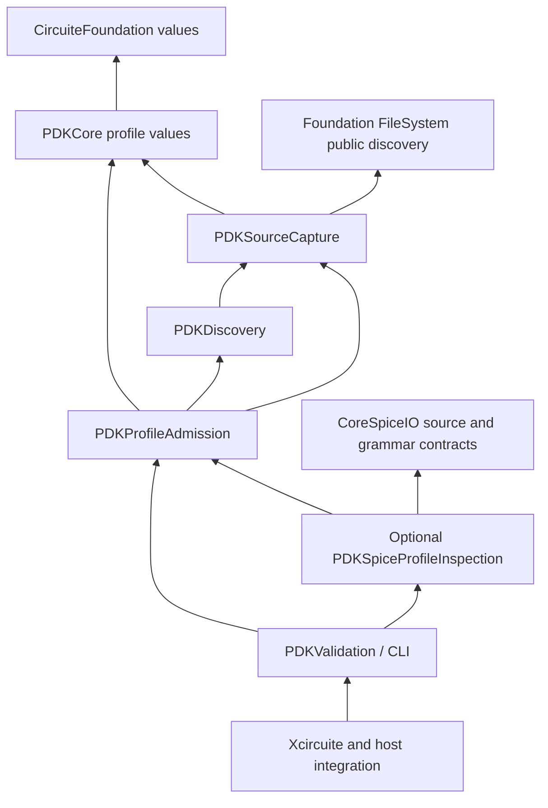

# PDKKit Design

## Purpose and Scope

Canonical process-design-kit discovery, identity and validation contracts.

The package now includes a local deterministic implementation of these
contracts, a retained corpus evaluator, standard-view inspection, immutable
oracle comparison and a local assessment evidence handoff.
The implementation is intentionally manifest-driven: the manifest is the typed
semantic index, while standard-format files remain immutable artifacts whose
bytes are verified by digest and size.
Parent: [LSI](../DESIGN.md). The affected child is
[PDKStandardViews](Sources/PDKStandardViews/DESIGN.md), alongside the independently
buildable [PDKSourceCapture](Sources/PDKSourceCapture/DESIGN.md) admission module.
Manifest validation is owned by [PDKValidation](Sources/PDKValidation/DESIGN.md).
The profile foundation is indexed below. PDKCore profile values and their isolated
test target, checked admission and stage consumption matching are implemented;
format adapters and host composition remain in progress.
Each implemented boundary records its behavioral evidence in its owning design.

## Responsibilities and Boundaries

This package owns the schemas and engine protocols listed in its public products. It must remain usable without UI state and without the Xcircuite runtime.

## Non-responsibilities

- Running DRC, LVS, PEX or simulation
- Declaring a tool qualified
- Mutating design data

## Architecture

```text
Swift/Foundation
       ↓
CircuiteFoundation artifact intent, identity and integrity
       ↓
PDKKit protocols and typed result schemas
                 ↓
PDKStandardViews parser-backed implementations
                 ↓
DesignFlowKernel stage execution (injected protocol)
                 ↓
Xcircuite concrete .xcircuite persistence
```

Backends may depend on lower-level data packages. This package must never import `Xcircuite` or `circuit-studio`.

## Contracts and Invariants

Kernel availability, corpus validation, oracle correlation, local evidence
handoff, process-scoped qualification and release approval are distinct states.
The package reports capability and evidence; ToolQualification and Xcircuite
apply process and flow policy.

## Artifact requirements

All outputs are immutable run artifacts with format, digest, producer metadata and the input design/PDK revision needed to reproduce the result.

PDKKit validation emits a `PDKCapabilityReport` plus immutable artifacts and
execution provenance. No local validation result is treated as foundry
qualification; ToolQualification consumes the evidence and owns trust state.

[PDKCore](Sources/PDKCore/DESIGN.md) owns manifest/asset values, identity projections
and asset declaration checks. View composition and status contracts are owned by
[PDKStandardViews](Sources/PDKStandardViews/DESIGN.md) and
[PDKValidation](Sources/PDKValidation/DESIGN.md).

`PDKAssetReference` is the PDK-owned artifact intent. Its
`artifactLocator()` projection uses `CircuiteFoundation.ArtifactLocator`.
`LocalPDKAssetResolver` materializes that intent through
`LocalArtifactReferencer`, producing a streaming SHA-256 and an immutable
`ArtifactReference`. PDK requests and results use CircuiteFoundation artifact
types directly, and each execution protocol refines `Engine` with its domain
request and result types.

Manifest validation and standard-view, rule-deck and oracle admission use
[PDKSourceCapture](Sources/PDKSourceCapture/DESIGN.md). Semantic readers consume
its verified immutable bytes. Canonical `ArtifactReference` values are retained
in standard-view IR, rule-deck payloads and oracle comparison payloads. Earlier
identity discovery remains separate and is not covered by capture budgets.

Corpus and oracle reports retain the selected PDK manifest digest so
ToolQualification can evaluate their scope together with independent process
evidence and human approval.

When a format-specific semantic parser or reference oracle is unavailable,
the validator emits a structured `blocked` result. It does not infer
cross-view correctness from file existence alone.

The corpus evaluator preserves this distinction by treating an expected
blocked case as a passing corpus case only when the declared blocker is
reproduced. This is test evidence, not qualification evidence.

The selected LEF/GDSII/OASIS adapters depend on `swift-mask-data` only in the
`PDKStandardViews` target. LEF physical declarations are retained as the
standard-owned `LEFDocument`, alongside PDK-owned identity, validation and
inventory facts. [StandardInspection](Sources/PDKStandardViews/StandardInspection/DESIGN.md)
owns complete observed layer names, including actual geometry references; engine
source mapping uses this inventory without synthesizing declarations. This replaces the names-only physical projection: duplicating
cell/pin/via/rule fields in a second PDK schema would create another independent
loss boundary. PDKCore and portable domain manifests do not gain this dependency.
SPICE and Liberty retain their existing PDK-owned inspection schemas.

The artifact digest and byte count used by the semantic parser must agree with
the actual in-memory bytes parsed, not only an earlier read of the source path.
Inspection remains distinct from engine capability and process qualification.

## Related Designs

| Design | Relationship | Contract Used | Summary | Cautions |
|---|---|---|---|---|
| [LSI](../DESIGN.md) | Parent | Exact process evidence | Platform composition | Inventory does not establish production closure |
| [PDKCore](Sources/PDKCore/DESIGN.md) | Child | Manifest and asset identity | Declaration checks and resolution | Resolution does not authenticate declarations |
| [PDKDiscovery](Sources/PDKDiscovery/DESIGN.md) | Child | Discovered/exact manifest loading and invocation-bounded candidate/decode entrypoints | Reference-construction owner | Legacy loading does not prove invocation bounds |
| [PDKStandardViews](Sources/PDKStandardViews/DESIGN.md) | Child | Retained standard semantics | Inspection boundary | Unsupported grammar fails explicitly |
| [PDKValidation](Sources/PDKValidation/DESIGN.md) | Child | Manifest and composed validation | Validation results | Admission does not imply qualification |
| [PDKSourceCapture](Sources/PDKSourceCapture/DESIGN.md) | Child | Bounded exact owned parser input | Manifest/view/rule-deck admission | Successful cleanup is part of source admission; captures do not imply a closed PDK graph |
| [PDKProfileAdmission](Sources/PDKProfileAdmission/DESIGN.md) | Child | Checked exact profile admission and stage consumption comparison | Independent host module without Engine codecs | Native format adapters and host adoption remain separate |
| [PDKSpiceProfileInspection](Sources/PDKSpiceProfileInspection/DESIGN.md) | Planned child | CoreSpice grammar adapter | Optional standalone host product | No CoreSpice-to-PDK reverse dependency |
| [PDKKitCLICore](Sources/PDKKitCLICore/DESIGN.md) | Child | Standalone command composition and scoped output | Inventory implemented; bounded profile commands specified | Actual output delivery is part of completion |
| [PDKDesignDatabaseIntegration](../PDKDesignDatabaseIntegration/DESIGN.md) | Used by | Canonical exact profile/source retention | Host-only schema/runtime | Existing database locks/plans remain authoritative |
| [LEF](../swift-mask-data/Sources/LEF/DESIGN.md) | Depends on | LEFDocument and typed errors | Standard physical schema ownership | Consumers must resolve process names and capability |

## Verification and Change Impact

Identity construction is specified by
[PDKDiscovery](Sources/PDKDiscovery/DESIGN.md) and its
[ManifestLoading](Sources/PDKDiscovery/ManifestLoading/DESIGN.md) child, using the
[Core Identity](Sources/PDKCore/Identity/DESIGN.md) contract. Core values, the manifest loader and Xcircuite exact handoff are implemented.
The standard test-inventory registration remains open in PROGRESS IM3/IM4. Existing discovery-before-capture and parser budget
limitations continue to apply. Exact database locks and canonical PDK persistence
remain owned by the existing system/database integration designs.

PDKStandardViewTests verifies actual inspection, source identity, retained
physical fields, serialization and parser failures. PDK validation/corpus and
external-provider tests verify composition. Physical engines must separately
prove placement, pin access, routing and extraction against the retained view.

For the identity-composition correction, native verification includes the full
106-test package, seven real CLI cases and four real Xcircuite public-API stage
executions with immutable artifact verification and ledger retention. The changed
PDK objects were verified under a temporary consumer override, which was removed.
The large Xcircuite test product did not execute within its build timeouts; this
evidence covers the four API paths, not that complete test product.

## Profile Foundation Specification and Implementation Order

Status: implementation in progress, not process qualification. S1 requiredness/
structural dependency refusal, S3 lower contracts, S4 bounded source/discovery and
S5 checked admission/consumption comparison are implemented with focused Native
evidence. S6 adapters/CLI, S7 host adoption and S8 cumulative integration remain
in progress; implementation of lower contracts does not establish those upper paths.
Scope: close requested-requiredness, exact corner/view/source closure, cooperative
invocation budgets, domain-consumption comparison and standard verification
ownership. Existing numerical algorithms, foundry grammar coverage, process
qualification and release policy remain domain/system responsibilities. A backend
without required meaning/accounting must block; unsupported production inputs are
not reclassified as complete. Backward compatibility is not required.

Confirmed current facts and requirement deltas:

| Observed implementation path | Current fact | Contract closing the gap |
|---|---|---|
| LocalPDKValidator asset-resolution catch | Uses manifest requiredness only; required-role CLI can complete with a missing optional extraction asset | Validation VV-01 |
| LocalPDKStandardViewInspector SPICE default branch | Active include can be ignored while inspect/validate complete | StandardInspection refusal + grammar adapter PA-03 |
| Required-corner inventory / view name matching | Empty corner asset/view binding can pass inventory; this is not a selected executable profile | Profile PV-02..03, admission PA-04 |
| Native STA STATimingProcessInputs | Already verifies explicit PVT/corner-to-exact-Liberty selection | Preserve ProcessCorners; add common-profile consumption PA-06 |
| SPICEDeckLoader / SPICECapturingFileResolver | Own grammar-driven includes and bounded unique source inventory; current path search does not enforce a producer's expected graph | CoreSpice exact-source intake + profile adapter |
| LocalArtifactReferencer / directory discovery / manifest codec | Prior discovery and decode are outside capture budgets | Foundation FD-01..04 + invocation accounting/decode |
| Xcircuite PDKIdentityHandoffTests / workspace inventory | New target executes independently but has no standard shard owner | Standard inventory and isolated product ownership |

The common guarantee is selected input admission, owned by the child designs;
this package does not duplicate their definitions. Profile success proves exact
selected sources and required source facts. Engine capability/numerical execution,
oracle correlation, process qualification and release remain separate states.



The arrows are compile-time dependencies, including planned ones. Availability
and injected facts do not reverse these directions. Existing PDKStandardViews
format adapters implement the required profile fact/accounting boundary without
moving physical standard semantics into PDKCore. CoreSpice exports its own generic
source intake; it has no PDK dependency. CoreSpice package adoption follows the
same exact-graph process as the Foundation public extension.

The following is the implementation contract/order, not an executable task list
or authorization to change production sources during this design task. Each row
is a separately reviewable, committed sprint with its own boundary and proof.

| Sprint | Owner / responsibility | Depends on | Completion evidence |
|---|---|---|---|
| S1 | PDKValidation effective-requiredness and unsupported active dependency refusal | Existing capture | Real API/CLI missing optional-but-required asset blocks; active unsupported include blocks; valid leaf stays valid |
| S2 | Workspace verification ownership | Existing committed test targets | Inventory owns existing PDK test products and the new dedicated handoff target; focused product preparation and nonzero method execution; unrelated inventory/API dirt stays separately reported |
| S3a | Foundation bounded source discovery/enumeration public API | Current FileSystem contract | FD-01..04 real security/lifetime/budget tests; host sanitizers; portable Core target separation; new exact version available for adoption |
| S3b | PDKCore immutable profile values/canonical codec/accounting boundary | Existing identity values | PV-01..06 focused pure tests and canonical vectors |
| S3c | CoreSpice dependency events, exact intake and cooperative work | Current parser/source contracts | Real grammar, source drift/context/work/cancel tests; no PDK dependency |
| S4 | PDK SourceCapture/Discovery bounded candidate and manifest decode | S3a,S3b | Root/candidate/cumulative read/decode boundaries; cleanup and cancellation; no budgetless referencer fallback |
| S5 | PDKProfileAdmission checked selection, graph and resource lifetime | S3b,S4 | PA-01..07 independent native capture/provider tests; dedicated codec-free target |
| S6 | Native format adapters and standalone profile CLI composition | S3c,S5 | Actual SPICE dependency graph; required physical/deck facts and accounting or explicit blockers; CLI exact profile/refusal/claim replay |
| S7 | Engine-consumption and host/database schema handoff | S6 | Preserve existing strict STA; actual simulation include inputs; selected physical/signoff subset; missing/extra/wrong source refusal; exact retained revision/profile/claim |
| S8 | Whole-task normal dependency and standard verification integration | S1,S2,S3a,S3b,S3c,S4,S5,S6,S7 | No edited packages; required focused/native stage products; claim resume refusal and ordinary shard ownership; remote resolution only when task-only commits can be published normally |

S3a/S3b/S3c have disjoint repositories and may run in parallel when explicitly
scheduled; admission and source/accounting changes stay serial where they share
mutable contracts. Tests build their actual dedicated product, not a broad test
product under a filter. Reuse unchanged lower behavioral evidence and verify
changed assumptions at each composing owner.

Production acceptance also requires PRD-011's explicit TT/SS/FF, required views,
model/deck/extraction and exact library inputs, all with supported source semantics
and invocation accounting. The miniature retained fixture proves refusal and
composition, not foundry/process readiness. Required native numerical and Metal
paths use their owning verification backend; this specification creates no
WASM/Embedded or qualification execution evidence.
