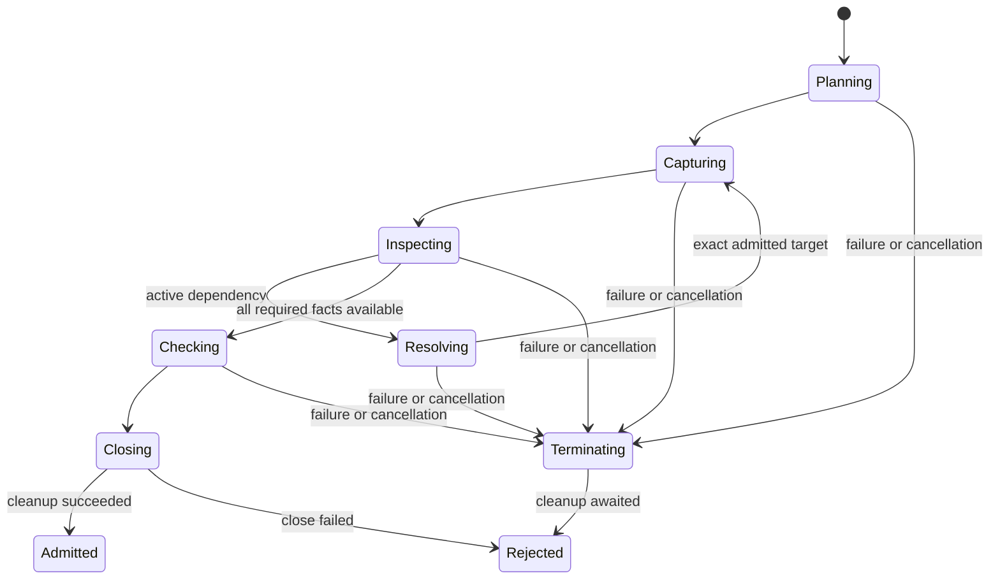

# Profile Admission Algorithm

## Purpose and Scope

Status: native implementation; focused behavioral proof owns acceptance. Parent:
[PDKProfileAdmission](../DESIGN.md). No children. Implement its public contract,
source traversal, checked publication and invocation accounting. All production
algorithm files belong here; module root is only the public composition boundary.

## Responsibilities and Boundaries

Keep selection algorithms deterministic and acquisition separate from syntax.
Providers receive captured input and an exact dependency resolver, not arbitrary
filesystem access. The accounting state owns admission/resource counters, not
technology semantics or host policy defaults.

## Related Designs

| Design | Relationship | Contract Used | Summary | Cautions |
|---|---|---|---|---|
| [Module](../DESIGN.md) | parent | PA-01..07 and budgets | Public contract authority | No duplicate invariant definition |
| [Profile values](../../PDKCore/Profile/DESIGN.md) | depends on | PV-01..06 | Pure declarations and canonical identity | Wire values remain claims |
| [Capture](../../PDKSourceCapture/Capture/DESIGN.md) | depends on | Checked capture and borrow lifetime | Resource-bearing bytes | Cleanup completion precedes publication |

## Architecture



## Contracts and Invariants

Implement PA-01..07 by the following internal steps:

1. Validate the request and reserve definition/manifest decode capacity before
   loading. Verify full identity on both inputs and build indexes within limits.
2. Resolve each explicit requirement against copied manifest values. Include all
   manifest-required support assets in the mandatory admitted set; a profile
   cannot downgrade `asset.required`. Derive each stage projection explicitly.
3. Acquire each content buffer once per invocation. Key byte reuse by content
   identity, and separately validate each full descriptor/semantic source key.
4. Track contextual source key + selected section + preprocessing environment
   on the active expansion stack. A repeated active context is a cycle; a later
   nonrecursive occurrence reuses bytes but records a new ordered edge/work cost.
5. The provider's dependency request resolves only against the definition's
   declared root-relative routes. Record the chosen exact edge before its content
   can contribute. Unknown/ambiguous routes fail without searching current cwd.
6. Check provider source references, dependency resolutions, supported/lost facts
   and requirement coverage. A provider cannot supply a successful empty claim
   for a required format or mask a resolution failure already recorded by the
   resolver. Independently compare source facts and selected mappings.
7. Freeze the ordered graph/selection, generate the canonical identity and await
   all operation-scoped cleanup. Publish the checked admitted value only after
   its final cancellation/deadline check. Retained storage reservations transfer
   to the value's owner; failed publication releases them after cleanup.

## Runtime Flows

Planning is I/O-free after exact inputs have been loaded. Semantic dependency
requests are ordered by the format parser; only independent roots may acquire
concurrently. Reuse does not reorder lexical includes or model shadowing.
Consumer verification derives the expected closure from explicit requirements,
then compares actual domain source/selection claims under PA-06. It is a module
function using protocols, not an overridable derived algorithm requirement.

## State, Ownership, and Lifecycle

The invocation actor owns the source/in-flight registry and opened acquisition
records. Each traversal task owns its context stack and mutable parser facts;
ordered merge publishes immutable results. Register an in-flight source before
awaiting its acquisition, and let aliases join that owned result.
`Mutex<AdmissionResourceState>` stores limits, cumulative counters, live
reservations and closed state. Reserve/release/check are synchronous; clock
sampling and cancellation observation are passed into short state checks.
Resource callbacks, filesystem operations and provider execution occur outside
the lock. Source/fact handles retain the resource owner until their final release.
No target branch removes synchronization or Sendable.

## Failure, Concurrency, and Constraints

Once terminating starts, reject new source opens and dependency expansions.
An already recorded primary/resolution failure cannot be erased by provider
success. Cleanup follows the same ownership path on throw and cancellation.
Reservation release is idempotent by internal reservation identity, while user
operations cannot mint/reuse these internal ownership identities. Charge retries,
duplicate semantic expansion and conversion work; refund only live capacity.

## Verification and Change Impact

Owner: `PDKProfileAdmissionTests/ProfileAdmissionTests`,
`AdmissionLifecycleTests`, `AdmissionCollectionTests` and
`PDKProfileAdmissionTests/ResourceAccountingTests`. Use the public admitting API
with real temporary files for root/dependency drift, and deterministic injected
clock/providers for cumulative/cancellation/lifetime cases. A false provider
reference, suppressed resolver error or extra source must be rejected. Concurrent
reserve/release and owner-copy lifetime tests must prove no over-admission or
double release. Changes affect module admission and profile-consuming callers.

## Checked Runtime Boundary

The PA-01..07 invariant authority remains the parent module. Native admission
accepts `PDKProfileAdmissionRequest` with an exact definition binding, explicit
manifest availability binding, authorized roots, exact source-key bindings,
checked budget and inspection-policy identity. Availability uses caller-provided
root URL/root ID and checked relative paths; no path/environment/cwd fallback.
The definition is captured and bounded-decoded first; its own exact manifest
reference is then reloaded through `PDKBoundedManifestLoading`. A supplied
manifest cannot authenticate admission. Pure `PDKProfilePlanning` remains an
I/O-free checked selection boundary accepting already decoded values/references.

Selected and mandatory-support root contexts use the definition's separately
checked initial preprocessing identity, under the
[Profile value contract](../../PDKCore/Profile/DESIGN.md#initial-preprocessing-identity).
The admission owner transports this identity; the inspector's grammar owner
verifies it against the actual initial inputs. Child contexts use each observed
dependency's actual child-entry identity. Inspection policy is never substituted
for an initial environment, and corner selection does not alter it implicitly.

### Shared-owner composition prerequisite

The standalone CLI requires a new `PDKProfileAdmitting` protocol requirement
`admit(_:resources:)` accepting a trusted external invocation accountant. This
entrypoint composes a trusted caller-owned accountant. Its configured limits/accounting version
must correspond to `request.budget`; composition supplies the same checked budget
to both. It neither creates another accountant nor closes the external owner.
Existing `admit(_:)` remains the native convenience owning creation and close.
The supplied accountant is the owner retained by input authority and all resource
receipts; no concrete native-accountant cast is required. Budget correspondence is
a trusted composition assumption because Core accounting exposes operations, not
configuration introspection. Both entrypoints execute the same admission algorithm.
External owners retain the original deadline and cumulative charges through input,
admission and output, then close after their terminal delivery. The
[CLI owner](../../PDKKitCLICore/ProfileCommands/DESIGN.md) owns that longer lifetime.

| Public value | Meaning and owner |
|---|---|
| PDKProfileAuthorizedRoot | Absolute caller-selected root URL and root ID |
| PDKProfileSourceBinding | Definition-local source key, approved logical route, root ID and checked physical relative path |
| PDKProfileExactBinding | Full reference plus explicit availability |
| PDKProfileSourceContext | Source key, selected section, corner ID and preprocessing identity |
| PDKProfileSourceInput | Internal construction only; exact capture, context, invocation identity and owned ancestry |
| PDKProfileDependencyRequest | Parent input, physical position/ordinal, directive/literal route and child context |
| PDKProfileDependencyEvent | Internal construction only; Core edge plus observed parent/child contexts |
| PDKProfileSourceCoverage | Actual input, independently observed section, explicit leaf/complete guarantee, inactive evidence and active events |
| PDKProfileMappingFact | Typed origin, demanded kind, name, terminal/layer observations |
| PDKProfileSourceFacts | Bound input, parser/policy identity, mappings, PVT/temperature facts, context coverage, events and unsupported/lost meaning |
| AdmittedPDKProfile | Internal checked construction only; canonical claim, exact owners, facts, graph and resources |

Provider registration identifies exact format, parser identity and policy identity.
Injected inspectors are trusted cooperative implementations, not independent
admission authorities. They must pre-admit their parse/projection/scratch work,
retain all work until completion, await every resolver call and join any children.
Facts construction transfers managed output ownership only after reserving the
explicit copied arrays and variable field backing. Providers report coverage for
every context they actually parsed, including dependencies obtained from the
resolver. Successful empty demanded mapping/fact coverage is refused. Operating
or characterization PVT is independently compared with the selected corner;
operating temperature is checked separately, and model TNOM cannot satisfy it.
Manifest cross-view logical/physical names, layer IDs and device IDs are checked
against source-origin facts, independently of the provider's coverage assertion.

The approved definition dependencies are the exact active union for the selected
contexts. Core v1 has no parent-section field; admission retains an internal
context-to-edge association. If an approved edge belongs only to an inactive
section and is never observed, reject dependency drift. Never silently omit that
edge or publish an overincluded Core claim. Later stage projection uses observed
contexts, not a guessed parent context. No Core canonical representation changes.

## Registry and Resolver Lifecycle

```text
register content before await -> exact capture -> publish registry completion
alias -> join original result -> content-safe rebind -> validate full context
provider resolve -> authorize route + expected occurrence -> record event
    -> capture/join child -> owned lineage -> provider parse and coverage
provider returns -> sticky failure check -> coverage/identity/mapping/PVT check
all contexts checked -> exact active union -> canonical claim -> final check
    -> retain immutable admitted owner -> convenience entry closes its accountant
failure -> await owned acquisition completion -> release invocation temporaries
external entry success/failure -> caller retains original accountant and closes it
```

An invocation actor owns linear content records and in-flight waiter continuations;
no detached/unstructured task or hidden hash-container growth is used. The original
structured caller owns acquisition; a waiter joins that exact outcome. Independent
root inspections are currently serialized, preserving deterministic global lexical
order and ordinary capture concurrency accounting. There is no pre-spawn lease
bridge or double acquisition charge. Provider dependency calls retain full ordinary
accounting. Each source input carries the invocation identity and an immutable
owned ancestry; repeated active context rejects a cycle, later nonrecursive
occurrences retain separate event order while reusing bytes.

A resolver actor records the first failure even when the provider catches it.
Closure coverage and provider event ordering are compared against resolver-owned
observations. Exact route resolution applies parent-relative lexical segments,
then ordered search routes, inside the declared logical source table; physical
availability is separately caller-bound. Unknown, ambiguous, absolute or escaping
routes cannot become newly approved identities.

| Mutable state | Storage / isolation | Entry point | Release |
|---|---|---|---|
| Content and in-flight records | Invocation actor + admitted slot collection | Actor acquire/complete | Structured completion then retained owner |
| Resolver observations and first failure | Invocation actor | Actor resolve/check/freeze | Retained graph / failed invocation |
| Local validation/collection builders | Exclusive local values | Synchronous checked methods | Scope / admitted immutable copies |
| Native resource counters | Parent native Mutex owner | reserve/check/close | Last receipt copy |

Slot collections reserve geometric optional-element capacity before allocation,
initialize and migrate cooperatively, and release obsolete capacity after replacing
old storage. An immutable identity marker follows every collection copy and its
private array. Before append/replace on shared backing, reserve and cooperatively
copy the entire existing managed capacity even when no geometric growth is needed.
A refused clone preserves both snapshots. Terminal completion uses only unique
actor-owned collections and range indices that retain no collection; it allocates
nothing and does not reopen closed accounting. Array capacity means explicit managed slots, not allocator rounding or
RSS. Source captures and decoded values retain their original owners; shared content
is never charged again merely for descriptor rebinding. No target-specific raw-state
or weakened Sendable branch is introduced. This host product makes no WASM/Embedded
runtime capability claim.

Root occurrence evidence distinguishes selected requirement occurrences from
mandatory support occurrences. All support sources remain captured and verified
in the admitted profile; the later consumer projection owns their stage treatment.
Include-depth admission checks the explicit owned ancestry depth before acquiring
each node, with a scoped depth reservation. The format provider remains responsible
for charging its own live parsing stack and joining every traversal child.

The request's caller-created availability arrays and inspector registrations are
caller-owned input, not new invocation allocation. The checked facts factory copies
its published arrays and variable strings under retained reservations; original
provider scratch storage remains charged until those copies finish. Reservation
bookkeeping and native allocator rounding are implementation overhead.

Input-derived reference mismatch failures retain an immutable
`PDKRetainedAdmissionFailure`: the exact decoded definition and definition capture
remain charged until the last copied failure is released. The owner never retains
the registry/resolver actor. Static and resource failures do not retain unnecessary
input payloads. `underlyingReason` and `isCancellation` preserve typed classification
through the wrapper. Extracting a raw `underlyingReason` or other raw value field
transfers any separately retained backing to the caller's accounting scope; retain
the checked owner while borrowing/inspecting payloads under invocation accounting.

## Focused Proof

The dedicated tests use real exact files and injected cooperative providers.
Falsifications include definition/manifest/descriptor drift, required support,
contextual cycle, repeated nonrecursive edges, missing/extra/inactive edges,
suppressed resolver failure, false provider identity/empty coverage, mapping/PVT
mismatch, same-content descriptor aliases, cumulative quotas, cancellation and
last-copy profile/facts/failure lifetime, and copied collection mutation/refusal.
Lower capture/decode evidence is reused; this sprint
owns their composition and checked publication, not another parser implementation.

[`SharedAccountantAdmissionTests`](../../../Tests/PDKProfileAdmissionTests/SharedAccountantAdmissionTests.swift)
owns the external-accountant composition proof: protocol witness invocation,
preceding cumulative charges, post-admission work, original deadline, unchanged
failure counters, no implicit close, and final-copy capacity release. The native
convenience ownership regression remains with the existing lifecycle tests.

## Native Invocation Observations

`PDKAdmissionResourceObserving.snapshot()` is the read-only observation requirement
implemented by the native `LocalPDKAdmissionResources`. It returns exactly one
entry for each current Core dimension, in Core declaration order: configured
limit and either cumulative total or live current/peak. The snapshot also retains
the configured accounting version and elapsed limit, the elapsed `Duration` sampled
from the original monotonic start, deadline status and closed status. It is
operational evidence; it cannot authorize work or establish command completion.
The [CLI owner](../../PDKKitCLICore/ProfileCommands/DESIGN.md) chooses its reporting
boundary and performs its own final work/delivery check.

The existing `Mutex<State>` owns current counters, live peaks and closure. An
accepted live reservation raises its peak to the maximum accepted simultaneous
charge; release reduces only current. A refused reservation changes neither
current nor peak. Cumulative totals never reset or refill. Snapshot copies all
counter/peak/closed values in one short critical section. Its injected clock is
sampled outside the lock, as with reserve/check; elapsed is that sample rather
than a promise about the subsequent copy time. A sample before the original
start returns the existing typed clock capability failure. Trusted clocks remain
monotonic; concurrent calls may enter the lock in a different order from their
outside-lock samples, so observation does not reinterpret call order as clock
progression.

Observation remains available after quota refusal, deadline, cancellation and
close. Deadline expiry is reported explicitly, including at the exact boundary;
observation does not perform or replace an admission check. Cancellation of the
observing task is not an invocation status and does not fabricate successful work.
Retained receipts continue to release current capacity after close, and subsequent
snapshots expose that release while retaining peaks and cumulative totals. No
external callback, clock invocation, I/O or await executes under the Mutex.

Counter/peak tables and snapshot entries have a fixed current dimension count;
their bookkeeping follows existing native implementation-overhead ownership. They
do not recursively reserve payload capacity, introduce arbitrary keys, or claim
an RSS limit. All public observation values are immutable and Sendable. There is
no platform branch or weakened synchronization/conformance. Evidence is scoped to
the actual native host Admission target; no WASM/Embedded capability is claimed.

| Logical state | Native storage / isolation | Read entry | Mutation entry | Release |
|---|---|---|---|---|
| Cumulative charges | Fixed `UInt64` slots / existing Mutex | snapshot / accounting check | accepted reserve | Never refunded |
| Live current and peak | Fixed `UInt64` slots / same Mutex | snapshot / accounting check | accepted reserve; receipt release changes current only | Last copied receipt, also after close |
| Closure | Bool / same Mutex | snapshot / accounting check | close | Owner lifetime |
| Configured limits and start | Immutable owner fields | snapshot; outside-lock clock sample | Initialization only | Owner lifetime |

[`ResourceObservationTests`](../../../Tests/PDKProfileAdmissionTests/ResourceObservationTests.swift)
owns fixed-vocabulary/configuration and protocol-witness snapshots, simultaneous
reserve/release/snapshot coherence, retained-copy final release, quota/overflow
refusal with unchanged counters/peaks, elapsed progression/exact expiry and typed
backward-clock refusal. It also checks terminal cancellation/closure observation
and reentrant injected-clock access outside the lock. Existing accounting proof
remains reusable because reservation decisions and receipt ownership are unchanged.

Native Swift 6.4.0 dedicated-product proof passed 8 methods / 28 argument
executions, including concurrent reserve/release/snapshot and clock reentry.
