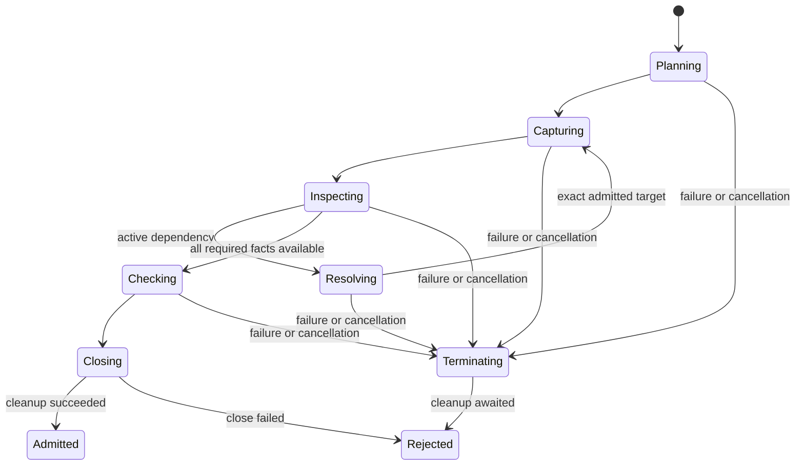

# Profile Admission Algorithm

## Purpose and Scope

Status: proposed implementation component. Parent:
[PDKProfileAdmission](../DESIGN.md). No children. Implement its public contract,
source traversal, checked publication and invocation accounting. All production
algorithm files belong here; module root is only the public composition boundary.

## Responsibilities and Boundaries

Keep selection algorithms deterministic and acquisition separate from syntax.
Providers receive captured input and an exact dependency resolver, not arbitrary
filesystem access. The accounting state owns admission/resource counters, not
technology semantics or host policy defaults.

## Related Designs

| Design | Relationship | Contract Used | Summary | Cautions |
|---|---|---|---|---|
| [Module](../DESIGN.md) | parent | PA-01..07 and budgets | Public contract authority | No duplicate invariant definition |
| [Profile values](../../PDKCore/Profile/DESIGN.md) | depends on | PV-01..06 | Pure declarations and canonical identity | Wire values remain claims |
| [Capture](../../PDKSourceCapture/Capture/DESIGN.md) | depends on | Checked capture and borrow lifetime | Resource-bearing bytes | Cleanup completion precedes publication |

## Architecture

## Contracts and Invariants

Implement PA-01..07 by the following internal steps:

1. Validate the request and reserve definition/manifest decode capacity before
   loading. Verify full identity on both inputs and build indexes within limits.
2. Resolve each explicit requirement against copied manifest values. Include all
   manifest-required support assets in the mandatory admitted set; a profile
   cannot downgrade `asset.required`. Derive each stage projection explicitly.
3. Acquire each content buffer once per invocation. Key byte reuse by content
   identity, and separately validate each full descriptor/semantic source key.
4. Track contextual source key + selected section + preprocessing environment
   on the active expansion stack. A repeated active context is a cycle; a later
   nonrecursive occurrence reuses bytes but records a new ordered edge/work cost.
5. The provider's dependency request resolves only against the definition's
   declared root-relative routes. Record the chosen exact edge before its content
   can contribute. Unknown/ambiguous routes fail without searching current cwd.
6. Check provider source references, dependency resolutions, supported/lost facts
   and requirement coverage. A provider cannot supply a successful empty claim
   for a required format or mask a resolution failure already recorded by the
   resolver. Independently compare source facts and selected mappings.
7. Freeze the ordered graph/selection, generate the canonical identity and await
   all operation-scoped cleanup. Publish the checked admitted value only after
   its final cancellation/deadline check. Retained storage reservations transfer
   to the value's owner; failed publication releases them after cleanup.

## Runtime Flows

Planning is I/O-free after exact inputs have been loaded. Semantic dependency
requests are ordered by the format parser; only independent roots may acquire
concurrently. Reuse does not reorder lexical includes or model shadowing.
Consumer verification derives the expected closure from explicit requirements,
then compares actual domain source/selection claims under PA-06. It is a module
function using protocols, not an overridable derived algorithm requirement.

## State, Ownership, and Lifecycle

The invocation actor owns the source/in-flight registry and opened acquisition
records. Each traversal task owns its context stack and mutable parser facts;
ordered merge publishes immutable results. Register an in-flight source before
awaiting its acquisition, and let aliases join that owned result.
`Mutex<AdmissionResourceState>` stores limits, cumulative counters, live
reservations and closed state. Reserve/release/check are synchronous; clock
sampling and cancellation observation are passed into short state checks.
Resource callbacks, filesystem operations and provider execution occur outside
the lock. Source/fact handles retain the resource owner until their final release.
No target branch removes synchronization or Sendable.

## Failure, Concurrency, and Constraints

Once terminating starts, reject new source opens and dependency expansions.
An already recorded primary/resolution failure cannot be erased by provider
success. Cleanup follows the same ownership path on throw and cancellation.
Reservation release is idempotent by internal reservation identity, while user
operations cannot mint/reuse these internal ownership identities. Charge retries,
duplicate semantic expansion and conversion work; refund only live capacity.

## Verification and Change Impact

Owner: planned `PDKProfileAdmissionTests/AdmissionTests` and
`PDKProfileAdmissionTests/ResourceAccountingTests`. Use the public admitting API
with real temporary files for root/dependency drift, and deterministic injected
clock/providers for cumulative/cancellation/lifetime cases. A false provider
reference, suppressed resolver error or extra source must be rejected. Concurrent
reserve/release and owner-copy lifetime tests must prove no over-admission or
double release. Changes affect module admission and profile-consuming callers.
