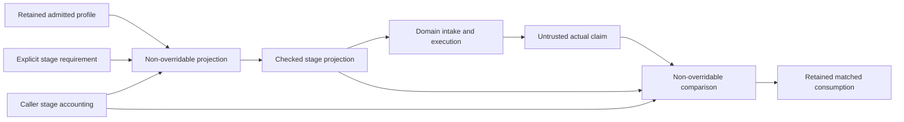

# PDK Profile Consumption

## Purpose and Scope

Parent: [Profile admission](../DESIGN.md). Child: [ExecutionBinding](ExecutionBinding/DESIGN.md).
Own the non-overridable
stage projection and actual-consumption comparison implementing PA-06. This
component composes the checked admission graph; it does not acquire, parse or
execute domain sources. Native implementation is present; focused behavioral
proof owns acceptance.

## Responsibilities and Boundaries

Derive a stage's explicit requirement/corner subset and its observed contextual
dependency closure from an `AdmittedPDKProfile`. Compare a domain's untrusted
`PDKConsumptionClaim` against that projection. Engines own actual observation,
executable semantics and capability; their claim is data, not an admission token.

Public module functions `projectPDKProfile(_:for:resources:)` and
`matchPDKConsumption(_:against:resources:)` return internally constructed
`PDKStageProjection` and `PDKMatchedConsumption`. Their derived algorithm has no
protocol-conformer override. The existing `PDKAdmissionResourceAccounting`
protocol is the injected resource boundary. No new generic graph framework or
identity codec is introduced. Source formats and numerical qualification remain
with their existing owners.

## Related Designs

| Design | Relationship | Contract Used | Summary | Cautions |
|---|---|---|---|---|
| [Module](../DESIGN.md) | parent | PA-06, PA-05/07 and resource policy | Consumer guarantee | No success from wire claims |
| [Admission](../Admission/DESIGN.md) | depends on | Checked roots, nodes, events and source facts | Immutable graph and byte owners | Use observed occurrence links, not guessed Core parent context |
| [Profile values](../../PDKCore/Profile/DESIGN.md) | depends on | Consumer requirement, contextual consumption records and bounded digest | Untrusted wire values | Observations preserve independent optional and signed layer fields losslessly; physical validity remains domain-owned |
| [ExecutionBinding](ExecutionBinding/DESIGN.md) | child | Proposed external-entry and full-execution source binding | Connect domain occurrences to the strict projection | Existing matching is not proof of this unimplemented connection |
| [Xcircuite](../../../../Xcircuite/Sources/Xcircuite/DESIGN.md#proposed-exact-pdk-profile-handoff) | used by | Explicit stage subset and retained result | Host stage composition | Domain capability and resume remain host-owned |

## Architecture



## Contracts and Invariants

CP-01: Requirement IDs and corner IDs must exist in the admitted profile.
Shared selections retain their explicit nil corner. Scoped selections use the
intersection with the stage's explicit corner IDs: each scoped requirement has
at least one selected corner, and each stage corner participates in at least one
selected requirement. An empty corner set cannot silently omit a scoped view.
Request set order does not change the projection; admitted canonical selection
order owns precedence within each explicit multi-source selection.

CP-02: Selected root occurrences and their observed child-node closure determine
stage inputs. Assign contiguous stage-local occurrence IDs starting at zero in
admitted source-occurrence order. Every child preserves its prior parent ID,
exact incoming dependency and full source context, including corner, section and
preprocessing identity. Preserve repeated nonrecursive occurrences and lexical
edge order. Never infer a parent section from the Core declaration alone.

CP-03: All mandatory support sources remain admitted and retained through the
projection's parent profile. A support-only root is not automatically a consumed
stage input. A support source reached by the selected closure or selected by an
explicit requirement is consumed in that occurrence context. This distinction
implements the host's explicit subset without weakening global support admission.

CP-04: Required mapping conditions come only from selected requirements and
their applicable manifest cross-view mappings. A demanded non-special fact kind
requires at least one observed candidate of that kind. Each explicit logical or
physical name, layer name/number/purpose, and device model with ordered terminals
requires at least one exact admitted candidate. Candidates may originate from
selected descendants, preserving the admission owner's existing fact contract.
Do not choose an arbitrary first candidate or require every enumerated library
observation. Unrelated partial layer observations remain losslessly available;
they neither become required candidates nor prevent a valid stage projection.
Dependency closure, section and operating PVT/temperature demands
are checked by the occurrence graph, selected sections and exact actual corners.

CP-05: Actual source records must match the entire expected ordered occurrence
list, including parent/edge, full descriptor, corner, section and preprocessing.
Actual selected corner/declared nominal PVT and selection sets must exactly match the stage projection;
ordered assets/source keys inside a selection retain precedence. Stage/config,
parent profile identity and expected projection identity must match. Missing,
extra or altered inputs fail. Every actual mapping must be an exact known
admitted observation from a projected occurrence, with no duplicate row. Each
required mapping condition must have an actual candidate. Additional known
observations from projected occurrences are allowed. No claim grants domain
capability or independently authenticates its domain evidence artifact.

The [profile value authority](../../PDKCore/Profile/DESIGN.md#selection-characterization-and-runtime-authority)
defines the selected-corner meaning. CP-02/05 describe the profile-scoped graph,
not a circuit's complete execution graph. External circuit entries require the
child execution-binding operation before a host may claim exact execution-source
consumption. Existing projection framing version 1 and schema-2 comparison remain
unchanged; an unbound standalone match cannot stand in for the proposed connection.

CP-06: Projection identity uses component-owned versioned canonical framing,
not JSONEncoder or unbounded hashing. Framed UTF-8 domain
`PDKKit.Profile.StageProjection`, version 1, parent semantic profile digest,
stage/configuration identity, canonical requirement/corner sets, selected
corners/PVT, selections, occurrence contexts/full references/incoming edges and
required mapping conditions bind the expectation. Parent identity binds the
exact manifest/definition and inspection policy. UInt64 values use big-endian
framing; optional tags and booleans use one byte; finite PVT binary64 values
normalize negative zero. Lexical occurrence and model precedence order is never
sorted away. Availability, budgets, run IDs and domain evidence do not enter it.

## Runtime Flows

```text
caller stage accountant -> validate explicit subset -> selected root occurrences
    -> iterative observed closure -> deterministic local occurrence IDs
    -> required mapping conditions/candidates -> sized canonical buffer/hash
    -> final cancellation/deadline check -> retained projection
domain actual claim -> identity/config -> ordered sources/context/edges
    -> exact corners/selections -> known mappings + required conditions
    -> checked evidence-reference copy -> final check -> retained matched result
failure -> scope-owned scratch/new output releases -> no checked publication
```

## State, Ownership, and Lifecycle

Projection retains its admitted parent, including every capture, decoded owner,
support source and source fact. Shared backing keeps its original reservations;
it is not charged again. The original admission accountant is closed and is
never reopened. Caller-provided stage accounting owns new collection capacities,
canonical scratch/hash work and comparison work, and may span several operations
without resetting cumulative counters. Checked output slot collections retain
their capacity receipts to their last copied owner. Canonical temporary storage
remains admitted through hashing, then releases.

Matched consumption retains the projection and a checked copied domain evidence
reference. It need not retain the untrusted claim's arrays. Claim storage supplied
by the caller remains caller-owned; extracting raw shared values from a checked
owner transfers backing-lifetime responsibility to that caller. Borrow/inspect
while retaining the checked parent/projection/result for managed lifetime.

| State | Storage / isolation | Read / mutation | Release |
|---|---|---|---|
| Projection traversal/builders | Exclusive local checked collections | Synchronous module algorithm | Scope / immutable output |
| Captures/facts and support | Retained admitted parent | Immutable public contract | Last parent/projection/result copy |
| Stage resource counters | Injected accounting protocol; native Mutex owner | Checked reserve/check | Last receipt / caller close |
| Canonical bytes | Pre-reserved local scratch | Two-pass checked writer | After bounded digest |

No target branch weakens Sendable or synchronization. This host component makes
no WASM/Embedded runtime claim and introduces no mutable shared state or I/O.

## Failure, Concurrency, and Constraints

`PDKProfileConsumptionError` distinguishes invalid stage subset, stage/profile/
projection identity mismatch, source occurrence mismatch, corner/PVT mismatch,
selection mismatch, unknown/duplicate mapping, unsatisfied required mapping,
value-construction failure and unchanged typed resource failure. Diagnostics use
static reasons and numeric indexes; errors do not retain uncharged input payloads.
Resource cancellation remains `.resource(.cancelled)`. Failure returns no
projection or matched value. Check cancellation/deadline before and after work
and immediately before publication; cooperative checks do not promise preemption.

Reserve checked `count * stride` slot capacity before output growth, temporary
byte capacity before canonical materialization, and cumulative parser/hash work
before execution. Native checked collection copy/growth semantics are reused.
Do not use unaccounted Set/Dictionary construction or opaque collection-wide
equality/sorting. Capacity reservations describe managed payload storage, not
allocator rounding, receipt bookkeeping or process RSS. Host limits remain
explicit caller policy, with no guessed production defaults.

## Verification and Change Impact

Owner: new Consumption tests in the existing
[PDKProfileAdmissionTests](../../../Tests/PDKProfileAdmissionTests) target; reuse
real admission fixtures and its codec-free product. Prove explicit subset success,
mandatory support retention without forced execution, unknown/missing corners,
multi-corner child accounting, repeated/missing/extra/reordered occurrences,
parent-edge/context/full-descriptor drift, section/preprocess/config/identity/PVT
and selection mismatch, required name/layer/terminal refusal, non-required known
mapping allowance, cumulative quotas, cancellation/deadline and last-copy owners.
Fix stage framing with deterministic vectors/order comparisons and actual bounded
hashing. Lower admission/capture proofs are reused until their assumptions change.
Changes affect Core consumption wire values, module PA-06 and host stage intake;
Engine numerical/format verification remains with its existing owner.
