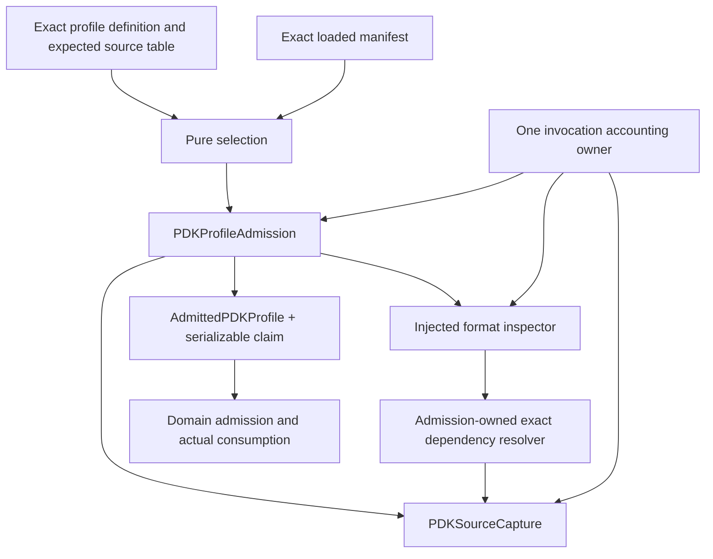

# PDK Profile Admission

## Purpose and Scope

Status: proposed specification, not an implemented SwiftPM target. Parent:
[PDKKit](../../DESIGN.md). Child: [Admission](Admission/DESIGN.md).
Own admission of one explicitly selected, exact process input profile, closing
the gaps identified by RA1..RA3 in [PROGRESS](../../PROGRESS.md).

The requested result is a reusable input guarantee, not execution or foundry
qualification. PRD-011's PDK responsibility is scoped here; tool image, candidate
corpus, host realization and release policy remain with their existing owners.

## Responsibilities and Boundaries

Introduce the `PDKProfileAdmission` library/test target to enforce a dependency
boundary: depend on PDKCore, PDKDiscovery, PDKSourceCapture and the required
CircuiteFoundation products; do not depend on PDKStandardViews, CoreSpice,
TimingEngine, DesignDatabase, Xcircuite or UI. Format-owned facts are injected.
PDKValidation and CLI compose admission; optional format adapters depend toward
this module. This separation enables real focused builds without mask/Engine
codecs. It is not a new framework, technology IR, storage layer or flow facade.

## Related Designs

| Design | Relationship | Contract Used | Summary | Cautions |
|---|---|---|---|---|
| [PDKKit](../../DESIGN.md) | parent | Process evidence and independent API | Package composition | Admission is not qualification |
| [Profile values](../PDKCore/Profile/DESIGN.md) | depends on | Definition, plan and claims | Selection and canonical identity | Wire claims must be re-admitted |
| [Manifest loading](../PDKDiscovery/ManifestLoading/DESIGN.md) | depends on | Exact loaded manifest | Source-consistent metadata | Existing loader needs invocation-budget migration |
| [Capture](../PDKSourceCapture/DESIGN.md) | depends on | Checked immutable bytes and cleanup | Exact source input | Same invocation accounting spans all sources |
| [Admission](Admission/DESIGN.md) | child | Bounded orchestration and provider requests | Concrete algorithm | Providers cannot acquire undeclared sources |
| [Validation](../PDKValidation/DESIGN.md) | used by | Admission plus current inventory validation | Status/evidence composition | Inspection flags cannot weaken profile requirements |
| [SPICE profile inspection](../PDKSpiceProfileInspection/DESIGN.md) | used by | Source context and exact resolver | Grammar-owned includes | No second SPICE parser |
| [Xcircuite](../../../Xcircuite/DESIGN.md) | used by | Profile/consumer claims | Run composition | Host status cannot replace domain checks |

## Architecture



## Contracts and Invariants

The following public interface is a proposed Swift contract. Resource accounting
requirements and lease/cost values are declared in PDKCore/Profile; this module
implements them, avoiding a lower-source dependency on this higher target. Referenced types
are proposed except existing CapturedPDKSource, PDKReference and Foundation
artifact types. Every existential operation is a protocol requirement; a generic
extension convenience is not the dynamic dispatch boundary.

```swift
public protocol PDKProfilePlanning: Sendable {
    func plan(_ request: PDKProfilePlanningRequest)
        throws(PDKProfilePlanningError) -> PDKProfilePlan
}

public protocol PDKProfileAdmitting: Sendable {
    func admit(_ request: PDKProfileAdmissionRequest)
        async throws(PDKProfileAdmissionError) -> AdmittedPDKProfile
}

public protocol PDKProfileSourceInspecting: Sendable {
    func inspect(_ request: PDKProfileSourceInspectionRequest,
                 dependencies: any PDKProfileDependencyResolving,
                 resources: any PDKAdmissionResourceAccounting)
        async throws(PDKProfileInspectionError) -> PDKProfileSourceFacts
}

public protocol PDKProfileDependencyResolving: Sendable {
    func resolve(_ request: PDKProfileDependencyRequest)
        async throws(PDKProfileAdmissionError) -> PDKProfileSourceInput
}

public protocol PDKAdmissionResourceAccounting: Sendable {
    func reserve(_ cost: PDKAdmissionCost)
        throws(PDKAdmissionResourceError) -> PDKAdmissionReservation
    func check() throws(PDKAdmissionResourceError)
}
```

`PDKProfileAdmissionRequest` supplies exact definition/manifest bindings, bounded
root availability and one budget. The native implementation is
`LocalPDKProfileAdmitter`, composed from existing capture/manifest-loading
contracts, a format registry, a monotonic clock and an invocation accounting
owner. `PDKProfileSourceInput` retains a checked capture and contextual selection;
format facts retain that full reference and parser/policy identity. Fact providers
report required unsupported/lost meaning explicitly. Custom providers are trusted
injected implementations of the same behavioral contract, not independent trust
authorities; their output is checked for identity, mapping and required coverage.


Public request/fact fields are fixed as follows; they are proposed APIs, not
aliases to undocumented existing types:

| Value | Required fields |
|---|---|
| PDKProfilePlanningRequest | Decoded definition, copied manifest and their exact references; no I/O authority |
| PDKProfileAdmissionRequest | Exact definition/manifest bindings, explicit authorized-root availability, budget and selected inspection policy |
| PDKProfileSourceInspectionRequest | Requirement IDs, corner/PVT, selected section/context, one checked source input and demanded fact kinds |
| PDKProfileDependencyRequest | Parent source key/capture, physical statement position and ordinal, directive kind, literal dependency route, selected section/context |
| PDKProfileSourceInput | Source key, full reference, checked immutable capture and exact context; retains live storage reservation |
| PDKProfileSourceFacts | Full input reference, parser/policy identity, observed typed mapping facts, explicit source-PVT evidence or absence, active dependency events and explicit unsupported/lost facts |
| PDKAdmissionCost | Accounting version, dimension and checked amount; cumulative work and live capacity have distinct dimensions |

Native planning validates structure/selection only. Admission reloads exact
bindings itself; a caller-supplied modified manifest snapshot cannot authenticate
an admitted profile. Expected dependency facts are compared with resolver events,
not merely a provider's self-reported list.

PA-01: All expected sources, including transitive dependencies, have full exact
SHA-256 reference and byte count before admission. Missing identity blocks.
Authoring/discovery may create a candidate definition, but cannot convert newly
observed includes into production-approved dependencies during exact execution.

PA-02: Every required binding resolves to captured bytes with the exact expected
reference. Reuse the same admitted buffer; do not hash a path independently of
the parsed read. Identity, descriptor, section and corner disagreement blocks.
Successful read-session/root cleanup is required before publishing admission.

PA-03: Every active dependency resolution is authorized by the definition's
source table and ordered logical resolution routes. No cwd, environment search,
symlink traversal, implicit mount override or unknown absolute include is used.
Record every active lexical include/library occurrence and full child identity.
Missing, ambiguous, cyclic contextual dependency or unsupported conditional
selection blocks; repeated nonrecursive includes preserve lexical precedence.
Every selected source requires format-owned dependency coverage or an explicit
format-owned leaf guarantee; an empty event list alone does not prove closure.
Inactive branches have explicit parser evidence and do not fabricate consumed
sources. Raw full-file identity remains bound even when a section is projected.

PA-04: For each requested view/corner, validate PV-01..03, parsed source-fact
coverage and explicit section selection. Names alone are not PVT evidence.
Manifest PVT bound to exact sources is declared operating-condition evidence;
Explicit operating/characterization PVT, when present, must agree under the
format owner's unit normalization. Actual temperature, characterization PVT and
model nominal temperature remain distinct source facts; model TNOM cannot replace
a selected operating temperature. When independently source-verified PVT is required and unavailable,
block that scope. Never claim numerical model validity from this declaration.

PA-05: `AdmittedPDKProfile` is an immutable Sendable value with an internal
checked initializer, no arbitrary public initializer and no Codable conformance.
It owns the canonical claim and retained source captures/facts. Its live resource
reservations remain retained for their actual lifetime, including copied handles.
A serialized claim, boolean inspector result or earlier producer receipt cannot
construct it. An injected alternate admitting implementation delegates to the
checked admission factory/algorithm rather than minting an unchecked token.

PA-06: The module owns the derived non-overridable consumer-match algorithm.
Given an admitted profile, explicit stage requirement and actual domain claim,
compare exact stage-projected roots, transitive closure, full references, PVT,
sections, preprocessing/configuration and required mapping. Every required
stage source is consumed; no undeclared source contributes. Allow a stage's
declared subset of a larger profile, and preserve explicitly admitted mandatory
support sources. Equal digests with different descriptors do not match. Domain
capability remains an independent check and may block an admitted profile.

PA-07: Failure produces no admitted value. Admission cancellation remains typed
cancellation, not an unavailable optional asset. Prior diagnostic evidence may be
retained as incomplete with exact completed phases. Cleanup errors retain both
primary and cleanup causes. Inspection failures do not become capability success.

## Runtime Flows

Exact definition capture -> bounded decode -> exact manifest loading -> pure
selection -> root admission -> contextual dependency traversal -> source-fact and
mapping validation -> canonical claim -> cleanup checks -> admitted value.
Consumer request derives an explicit projection -> domain exact read/intake ->
actual consumption claim -> PA-06 -> retained result. Resume reopens only the
retained exact bindings and re-admits any claim; it never discovers replacement
identities or silently selects a new corner.

## State, Ownership, and Lifecycle

An invocation-owned actor holds source captures and in-flight acquisition records;
caller tasks own their separate contextual stacks and local fact results. Ordered
merge holds edge occurrences/diagnostics; the same buffer is shared through its
immutable owner, without sharing mutable parser state. The accounting owner uses
`Mutex<State>` for short synchronous reserve/release/check operations on every
supported target. No I/O, callback or await occurs under the lock. Traversal jobs remain in an invocation-owned task group. Registry insertion
precedes any acquisition await; aliases join the same in-flight acquisition.
Concurrent independent roots are admitted only within the shared budget. Deterministic merge keeps
semantic edge order. Captures are retained and reused while memory permits;
there is no unexplained free/re-read cycle.

Reservations are checked immutable owner handles with exactly-once release at
last ownership release; cumulative work/read counts are never refunded. Retained
memory remains charged after admit returns. All opened async resources are closed
on success, failure and cancellation, with cleanup completion awaited in the owning
scope. A failed close prevents successful publication. No AsyncStream is needed. Cancel and join every child acquisition before
terminating the invocation; a waiter cancellation cannot leave an unowned task.

| Logical state | Storage / isolation | Read / mutation | Release |
|---|---|---|---|
| Resource counters and reservations | Mutex<AdmissionResourceState>, common source | Synchronous accounting requirements | Last reservation-owner release |
| Source registry and in-flight acquisition | Invocation actor | Actor methods; no shared raw dictionary | Cancel/join children, close resources |
| Parser/context stack and facts | One task's local state; immutable returned values | Owning task; ordered result merge | End of call / retained admitted owner |

No Native/WASM/Embedded branch changes these storage/Sendable contracts. Proposed
host products have no WASM/Embedded capability yet; future target adoption must
compile/link and run the corresponding isolation/lifetime tests before claiming
support. This specification alone provides no target execution evidence.

## Failure, Concurrency, and Constraints

Resource defaults belong to CLI/host composition, not physical semantics. The
library requires a caller-supplied checked budget. Defaults are chosen from a
short representative input inventory/measurement, recorded with accounting
version and adjustable within validated machine capacity. No guessed production
ceiling is fixed by this design.

| Budget dimension | Admission/check point |
|---|---|
| Search roots, scanned entries and candidates | Before enqueue/enumeration admission; discovery shares invocation accounting |
| Total bytes read/hashed, unique sources and pages | Before read/append/hash, including definition and manifest; retries consume remaining work |
| Contextual nodes, edges, include depth and expansions | Before graph insertion/recursive expansion; repeated includes still cost work |
| Decoded elements, nesting, scalar bytes and parser work | Before materialization/token/statement work; providers receive the same accounting owner |
| Live owned storage and temporary conversion capacity | Reserve before buffer/container growth; count capture, projections, codec copies and retained facts without double-counting shared backing |
| Elapsed admission duration | One monotonic start; check before/after I/O, parse chunks and final publication; it is not reset for each source |
| Concurrent acquisition and open resources | Reserve before spawn/open; release after actual completion/close |
| Diagnostic entries and retained diagnostic bytes | Before append; truncation is explicit and never removes the terminal failure |

Checked integer arithmetic rejects overflow before reserve/allocation. Capacity
reservations and measured allocation are distinct; framework/runtime overhead is
recorded during representative measurements and is not advertised as an exact
process-RSS cap. A standard JSONDecoder parse without bounded work/element
admission cannot satisfy this profile's decode contract. Required source readers
and codecs must opt into the invocation accounting contract before being used.

Elapsed checks reject late success; they do not promise preemption of blocking
native I/O or cleanup. Hard process timeout/tree cleanup remains an outer host
process contract. Required cleanup is not skipped to meet a deadline. A backend
without the required bounded/cooperative operations returns an unsupported-budget
capability error rather than silently using the old unbounded referencer.

Typed errors distinguish invalid definition, missing requirement/identity,
ambiguous selection, source/path/descriptor mismatch, missing dependency,
contextual cycle, unsupported required semantics, domain consumption mismatch,
resource exhaustion, cancellation and combined cleanup failure. Structured
diagnostics include requirement ID, corner, asset/source key, edge/statement,
expected/observed reference and phase when applicable. Do not expose credentials.

## Verification and Change Impact

Planned owners and falsifications:

| Invariant | Independent evidence owner |
|---|---|
| PV-01..06 | PDKProfileValueTests; pure value selection and canonical encoding |
| PA-01..04 | PDKProfileAdmissionTests; real exact captures plus injected format providers; missing/ambiguous/dependency drift cases |
| PA-05,07 | PDKProfileAdmissionTests; copied owner lifetime, cancellation, cleanup and no partial publication |
| PA-06 | PDKProfileAdmissionTests; a real consumption claim with wrong/extra/missing source, corner, section or descriptor must fail |
| Whole-invocation budgets | PDKProfileAdmissionTests + source/discovery tests; individually small sources exhaust cumulative limits, work/depth/diagnostic boundaries and cancellation during traversal |
| Real grammar and conditional branches | PDKSpiceProfileInspectionTests; actual CoreSpice parser, no mock include grammar |
| Runtime composition | PDK CLI and dedicated Xcircuite identity/profile test products; exact retained claims, blocked gate, re-admission on resume |

Each test target must be declared in the schema-3 workspace inventory with one
owner per executed method. Focused product compilation and nonzero execution
events are required; a filter alone does not prove compilation isolation.
Lower evidence remains valid until its owned assumptions change. Review/test a
stable sprint once; run cumulative integration after all affected sprints.
