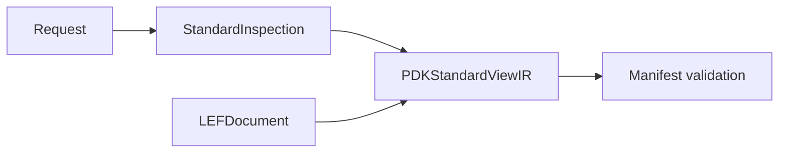

# PDK Standard Views

## Purpose and Scope

Own standard-view inspection protocols and results. Parent:
[PDKKit](../../DESIGN.md). Affected child:
[StandardInspection](StandardInspection/DESIGN.md).

## Responsibilities and Boundaries

Retain parsed facts with exact source identity and explicit failures. Standard
physical format schemas belong to swift-mask-data. PDK validation owns manifest
mapping; engines own executable process capability.

## Related Designs

| Design | Relationship | Contract Used | Summary | Cautions |
|---|---|---|---|---|
| [PDKKit](../../DESIGN.md) | Parent | Process inspection contract | Host standard views | No tool qualification inference |
| [StandardInspection](StandardInspection/DESIGN.md) | Child | Actual parsed bytes and values | Public IR and local inspector | No names-only physical completion |
| [PDKSourceCapture](../PDKSourceCapture/DESIGN.md) | Depends on | Verified immutable source | Manifest, view, rule and oracle admission | No path reread after capture; identity discovery is outside capture budget |
| [LEF](../../../swift-mask-data/Sources/LEF/DESIGN.md) | Depends on | Typed standard declarations | Physical source schema | Native capabilities remain separately validated |

## Architecture

## Contracts and Invariants

Completed LEF inspection retains the standard-owned document, source reference
and inventory facts derived from that document. Missing or unsupported semantics
cannot be inferred from names or successful JSON decoding.
The LEF inventory/declaration distinction and external-master inference boundary
are owned by [StandardInspection](StandardInspection/DESIGN.md).

Manifest-bound composition must compare the inspector's retained source reference
with the exact resolved asset reference before running binding validation. This
gate is owned by `LocalPDKManifestViewInspector` and applies to injected backends
as well as local parsing. Standalone locator inspection identifies current bytes;
it cannot replace the identity selected by manifest-bound resolution. Manifest,
rule-deck text and oracle JSON are decoded only from captured bytes. Capture
failure, cancellation and cleanup failure cannot produce completed evidence.

## Verification and Change Impact

[PDKStandardViewTests](../../Tests/PDKKitTests/PDKStandardViewTests.swift) owns
local parse and round-trip behavior. External inspection and manifest validation
tests own their boundary checks; physical engine evidence is independent.
