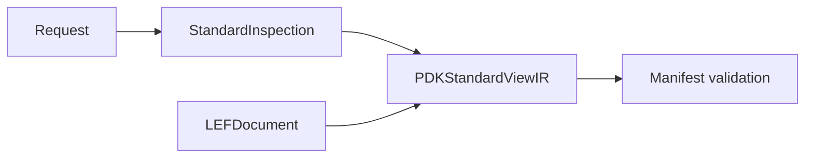

# PDK Standard Views

## Purpose and Scope

Own standard-view inspection protocols and results. Parent:
[PDKKit](../../DESIGN.md). Affected child:
[StandardInspection](StandardInspection/DESIGN.md).

## Responsibilities and Boundaries

Retain parsed facts with exact source identity and explicit failures. Standard
physical format schemas belong to swift-mask-data. PDK validation owns manifest
mapping; engines own executable process capability.

## Related Designs

| Design | Relationship | Contract Used | Summary | Cautions |
|---|---|---|---|---|
| [PDKKit](../../DESIGN.md) | Parent | Process inspection contract | Host standard views | No tool qualification inference |
| [StandardInspection](StandardInspection/DESIGN.md) | Child | Actual parsed bytes and values | Public IR and local inspector | No names-only physical completion |
| [PDKCore](../PDKCore/DESIGN.md) | Depends on | Asset identity findings and resolver protocol | Authoritative declaration checks | Current availability does not authenticate declarations |
| [PDKSourceCapture](../PDKSourceCapture/DESIGN.md) | Depends on | Verified immutable source | Manifest, view, rule and oracle admission | No path reread after capture; identity discovery is outside capture budget |
| [LEF](../../../swift-mask-data/Sources/LEF/DESIGN.md) | Depends on | Typed standard declarations | Physical source schema | Native capabilities remain separately validated |

## Architecture



## Contracts and Invariants

Completed LEF inspection retains the standard-owned document, source reference
and inventory facts derived from that document. Missing or unsupported semantics
cannot be inferred from names or successful JSON decoding.
The LEF inventory/declaration distinction and external-master inference boundary
are owned by [StandardInspection](StandardInspection/DESIGN.md).

Manifest-view, standalone view and rule-deck requests carry an optional
`expectedSourceArtifact`. When supplied, it is authoritative: a backend must not
replace it with a new identity from current availability. Standalone inspection
without an expected reference discovers current bytes. Manifest-bound inspection
checks every declared digest and byte count against the selected reference before
semantic admission, using PDKCore's asset-owned identity checks. An upstream
reference must also agree with manifest-bound resolution. Local parsing captures
against that reference; local and external results retain the same full reference.
Manifest composition checks the returned reference before binding, including
injected backends. Obsolete request schemas are rejected before acquisition. Request schemas advance to view 4, manifest-view 4 and rule 3.

```text
manifest declarations + upstream expected reference
  -> select and check asset identity -> capture expected bytes -> parse
  -> exact retained identity check -> binding -> result
```

Native manifest-view, rule and oracle result provenance retains the supplied
complete manifest reference (including producer descriptor). The rule source,
view source and oracle expectation identities are retained when available.
This list describes selected inputs and does not grant successful admission.

Manifest, rule-deck text and oracle JSON are decoded only from captured bytes.
Capture failure, cancellation and cleanup failure cannot produce completed evidence.
Cancellation thrown by a provider remains cancelled. Oracle aggregation preserves
an already observed failed view when a later view is blocked; cancellation stops
further view execution and preserves an earlier failure if one already occurred.

## Verification and Change Impact

[PDKStandardViewTests](../../Tests/PDKKitTests/PDKStandardViewTests.swift) owns
local parse and round-trip behavior. External inspection and manifest validation
tests own their boundary checks; physical engine evidence is independent.

[PDKIdentityCompositionTests](../../Tests/PDKKitTests/PDKIdentityCompositionTests.swift)
refutes declaration mismatches, upstream/path substitution, injected identity
substitution, status downgrade and cancellation conversion. Request serialization
retains supplied expected identities. External adapters enforce the same identity
and cancellation contracts as local implementations.
