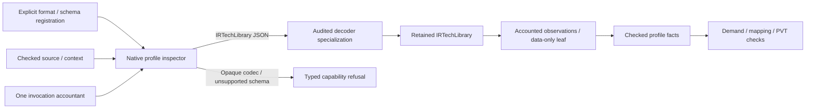

# Profile Inspection

## Purpose and Scope

Own native non-SPICE `PDKProfileSourceInspecting` registrations. Parent:
[PDKStandardViews](../DESIGN.md). No children. This component supplies one audited
`IRTechLibrary` JSON capability and explicit refusal for existing opaque codecs.
It does not add a physical schema, binary codec, extraction interpreter or process
qualification. The adapter is implemented and verified through its actual native
host decode, inspection and admission paths under the fixed Swift 6.4.0 toolchain.

## Responsibilities and Boundaries

Use the checked source input and its captured bytes, preserve its full reference
and context, and charge parsing, validation, projection and output construction to
the caller's invocation accountant. Source admission owns acquisition and cleanup.
The standard schema belongs to TechIR. Admission owns demanded-fact and manifest
binding checks. An unsupported reader cannot be selected by wrapping its structural
result or by preflighting the input byte count.

## Related Designs

| Design | Relationship | Contract Used | Summary | Cautions |
|---|---|---|---|---|
| [Module](../DESIGN.md) | Parent | Native inspection boundary | Public adapter composition | Engine capability is independent |
| [StandardInspection](../StandardInspection/DESIGN.md) | Coordinates with | Existing structural readers | Preserve existing standalone contracts | These readers provide no invocation accounting guarantee |
| [Profile admission](../../PDKProfileAdmission/Admission/DESIGN.md) | Depends on | Source inspection request, dependency resolver, checked facts, registration | Input and graph authority | Facts never create input authority |
| [ManifestLoading](../../PDKDiscovery/ManifestLoading/DESIGN.md) | Depends on | Audited decode specialization and retained document | Reuse cooperative syntax/typed decoder | Arbitrary custom Decodable allocations are outside its guarantee |
| [SourceCapture](../../PDKSourceCapture/DESIGN.md) | Depends on | Captured source and scoped bytes | Exact immutable input | Decoded document does not retain source buffer |
| [TechIR](../../../../swift-mask-data/Sources/TechIR/DESIGN.md) | Depends on | IRTechLibrary and existing nested Codable values | Standard-owned declarations | Schema/toolchain changes invalidate this specialization audit |

## Architecture



The public specialization protocol is `PDKStandardTechnologyDecoding`:
`decodeTechnology(_:resources:)` accepts `CapturedPDKSource` and
`any PDKAdmissionResourceAccounting`, throws `PDKBoundedDecodeError`, and returns
`PDKDecodedDocument<IRTechLibrary>`. Its native implementation delegates to the
existing concrete decoder's audited entry. The injectable native inspector
conforms to the existing `PDKProfileSourceInspecting` protocol.

`technologyRegistration(policyIdentity:decoder:)` creates the explicitly selected
`.json` / IRTechLibrary registration with a stable parser identity. It supplies no
budget defaults and performs no content sniffing or alternate-schema fallback.
`unsupportedRegistration(format:policyIdentity:)` creates a native refusal entry
for an explicitly selected non-SPICE format. Both return the existing checked
`PDKProfileInspectorRegistration`; format and policy choose the entry. Native JSON
inspection accepts request views nil, `.layerMap` or `.other`; other view semantics
are rejected. Dependency inspection can carry a nil view without weakening the
same JSON schema policy.

## Contracts and Invariants

| Boundary | Assumption | Guarantee |
|---|---|---|
| Input | Admission supplied a checked immutable capture and context | No locator reopening, identity discovery, Data copy or source substitution |
| Typed JSON | Explicit IRTechLibrary registration | Decode the standard type, not LayoutTechDatabase, PEX TechnologyIR or an inferred schema |
| Strict fields | Known fields at every typed object | Unknown fields fail before that object's typed field decoding; Dictionary keys remain data |
| Metadata | Empty metadata required by this accepted subset | No metadata-driven include, environment lookup, PVT or interpretation |
| Context | Supplied preprocessing identity is provenance | Parse the complete document unchanged; no JSON preprocessing inputs/options or invented independent root identity |
| Section | This data schema has no selected-section contract | Non-nil selectedSection and selectedSection demand fail explicitly |
| Closure | Strict data-only document, with no metadata or external execution | One format-owned leaf coverage record; no resolver call, event or inactive statement invented |
| Source association | Specialization result may be injected | Require present full decoded sourceReference equal to input.reference before facts |
| Publication | All format work and checked fact construction succeeded | Final shared cancellation/deadline check; no successful partial output |

The root admission validator checks all known root fields through existing Decoder
containers and requires empty metadata before delegating to
`IRTechLibrary.init(from:)`. It does not reconstruct the standard schema. The
decoder's opt-in strict typed-key mode checks each nested object's raw field against
the requested CodingKey family before decoding its fields; unknown keys cannot be
lost because a static CodingKey omits them. Existing document operations retain
their current mode. The reviewed TechIR family contains direct field assignments,
Array/Dictionary values and scalar/enum values, with no decode-time Set, sorting,
derived cache or independent buffer allocation. This audit is specific to that
family and the fixed codec/toolchain, not a guarantee for arbitrary Codable types.
The audited entry uses a synchronous, non-escaping `validate` hook on the same
Decoder. Root membership uses accounted byte scans against static field literals,
without a Set or materialized allCases; metadata is checked before standard decode.

### Technology Root-Key Compatibility Candidate

This isolated source candidate is based on public PDKKit
`1050fef9325df488d4de32ed3f078686d9e12d1a`. Restore the owned decoder body from
`8fc9e5ddd8a200fa14bf5b4146da6acfb2cbdbd8` byte-for-byte: only six accounted
root-key literals are added. No standard type, primitive interpretation, default,
inspection fact, capability or source identity is reconstructed in PDKKit.

Status: finite Native typed-data execution passed; one scoped review and
publication of this successor remain pending. The manifest now selects
published Mask `67410f834bdfa8a098c2ec0bfe3675210f658277`, whose Sources/Tests
retain exact original `83c926044838fe12f579bc9d2526a8e55899fa60` bytes and use
public CircuiteFoundation5f. Root verified its normal-main publication and exact
reviewed tree before this pin adoption. Fresh public resolution and focused execution passed on the exact selected
graph; publication still requires the scoped review to close.
CircuiteFoundation5f/CoreSpicecfc and owned MIT terms are retained.


The explicit accounted root membership matches the exact adopted IRTechLibrary
CodingKeys, including manufacturingGrid, unitDeclarations,
hasDatabaseUnitsDeclaration, obstructionSpacingUsesMinimumWidth,
propertyDefinitions and viaGenerationRules. The standard type remains the sole
field/enum/default authority; the specialization does not flatten quantities,
derive geometry, rescale precision declarations or reinterpret process rules.
The complete typed value and exact sourceReference are retained by
PDKDecodedDocument for its owned lifetime. Missing optional/defaulted fields keep
IRTechLibrary's legacy defaults. Unknown future root or nested fields and malformed
recognized types still refuse before publishing a document.

Profile inspection projects only its existing inventory and data-only closure
facts. Retained enclosure/hole/current/antenna/generation/property/unit data does
not add process-rule or electrical capabilities: demands for those meanings fail
unsupportedSemantics. The complete immutable input reference remains in coverage;
unused retained data is not reported as an executed law. Parser and leaf evidence
identities remain v1 because this fixes current standard-family decoding without
changing inventory/closure semantics or supported demanded fact kinds.

[StandardTechnologyDecodeTests](../../../Tests/PDKStandardProfileInspectionTests/StandardTechnologyDecodeTests.swift)
verifies populated retained process facts, full typed equality/source binding,
legacy omissions, malformed recognized types and future nested fields.
[StandardProfileAdmissionTests](../../../Tests/PDKStandardProfileInspectionTests/StandardProfileAdmissionTests.swift)
verifies inventory-only publication and explicit process-meaning demand refusal.

The additional positive admission case uses encoded populated values for ALL six
keys, exact capture bytes and the real native registration/admitter. Typed decode
and round-trip equality, legacy omissions, malformed recognized/nested fields,
unsupported process-meaning demands, shared resource refusal and final ownership
remain the qualification boundary. The unchanged bounded decoder product is the
one affected lower regression. Existing prior-revision evidence below does not
qualify this candidate or its new dependency graph.

| Fact kind | Exact origin | Limits |
|---|---|---|
| `layers` | IRTechLibrary.layers: name and optional gdsLayer | layerPurpose remains nil; datatype/type does not imply PDKLayerPurpose |
| `vias` | IRTechLibrary.vias: name | No fabricated device terminal ordering |
| `sites` | IRTechLibrary.sites: name | No cell, device or PVT meaning inferred |
| `dependencyClosure` | Complete accepted data-only JSON document | Explicit leaf coverage with the same input/context |

Original admission demand spellings are authoritative: `sourcePVT`,
`operatingTemperature`, `dependencyClosure` and `selectedSection` have dedicated
checks; all other demands match exact mapping fact kinds. This adapter supports
only `layers`, `vias`, `sites` and `dependencyClosure`. PVT/temperature, sections,
devices and unknown demanded meanings fail `unsupportedSemantics`. Empty observed
collections cannot satisfy a required mapping demand. A manifest-required full
layer binding still fails admission when actual purpose is absent; the adapter
does not fill it from the manifest. Shared or corner-scoped data retains its
incoming context, but this format supplies no source-derived PVT evidence.

LEF/GDSII/OASIS/Liberty and opaque rule-deck/extraction readers are refused before
codec invocation with `resource(unsupportedBudgetCapability(staticReason))`.
Unsupported JSON view/schema/extension meaning fails `unsupportedSemantics`;
malformed bytes/type shape fails `malformedSource`. Existing structural inspection
continues independently and grants no profile capability. Numerical deck execution
and foundry readiness remain with their existing owners.

## Runtime Flows

```text
shared resource check -> explicit format/policy branch
  -> opaque format: typed capability refusal before reader
  -> supported JSON: demand/context checks -> captured-span bounded decode
       -> strict typed fields / empty metadata -> existing IRTechLibrary
       -> full reference comparison -> accounted projection + explicit leaf
       -> checked fact constructor -> final resource check -> facts
```

## State, Ownership, and Lifecycle

All per-inspection work is local. There is no new shared mutable state, task,
background work or platform-specific synchronization branch. The injectable decoder
is Sendable. The existing decoder owns its synchronized receipt bookkeeping.

| Storage | Owner and lifetime |
|---|---|
| Captured bytes | Checked input; retained by returned facts through input |
| JSON syntax / validation / coding paths | Decoder temporary reservations through decode completion/failure |
| Typed IRTechLibrary backing | Returned decoded-document receipts, retained until projection and checked facts finish |
| Projection arrays and temporary observations | Adapter reservations admitted before growth; held through checked fact construction |
| Returned names / arrays / coverage | Checked facts constructor copies/accounting; reservations live through last facts copy |

The typed document is not detached while its values are in use. Returned facts own
their copied observations; they do not require an additional retained technology
document. Input strings used in errors are replaced with static classifications.
Each new loop, comparison, byte scan and field check charges/checks parserWork;
arrays, string growth and sorting, if introduced, require reviewed pre-admission.
Errors use static classifications. Fixed accountant and checked-factory
reservation-handle bookkeeping retain the existing lower-owner overhead exclusions
in [admission](../../PDKProfileAdmission/Admission/DESIGN.md). The native projection
has no growing receipt list. This is logical managed capacity, not allocator/RSS.

## Failure, Concurrency, and Constraints

Budget exhaustion, arithmetic overflow, closed accounting, original deadline and
cancellation preserve the original `PDKAdmissionResourceError`. Checks precede
codec work and refusal, so cancellation does not become unsupported capability.
Failure releases temporary/owned parse and projection receipts and publishes no
facts. Full reference mismatch from an injected specialization fails invalidFacts.
All budgets remain host-selected; this component chooses no operational limits.

## Verification and Change Impact

Focused owner: `Tests/PDKStandardProfileInspectionTests`. Its 15 behavioral methods
run the actual admission API with real exact captures and the native inspector,
plus injected decoder counterexamples. The stable production snapshot passed 14
methods in the whole runtime, then the corrected cumulative-work assertion passed
its focused runtime. The affected bounded decoder regression product passed all
11 methods. Builds and execution used Swift 6.4.0 and outer timeouts on the native
host; this evidence makes no WASM/Embedded execution claim.

| Test owner | Proven responsibility |
|---|---|
| [StandardTechnologyDecodeTests](../../../Tests/PDKStandardProfileInspectionTests/StandardTechnologyDecodeTests.swift) | Exact native typed decode, strict schema, malformed/depth refusal, quotas, cumulative work, cancellation, deadline and document retention |
| [StandardProfileResourceTests](../../../Tests/PDKStandardProfileInspectionTests/StandardProfileResourceTests.swift) | Native projection/fact quotas, cancellation/deadline, copied-fact/source ownership and empty-observation demand refusal |
| [StandardProfileAdmissionTests](../../../Tests/PDKStandardProfileInspectionTests/StandardProfileAdmissionTests.swift) | Actual delete-after-capture admission, mapping/closure/provenance, absent purpose/PVT, opaque capability and injected full-reference refusal |
| [PDKBoundedDecodingTests](../../../Tests/PDKBoundedDecodingTests) | Existing bounded document operations and audited strict-key entry regression |

| Fixed gap | Required behavioral evidence |
|---|---|
| Genuine typed JSON mapping / closure | Real IRTechLibrary capture yields actual layer/via/site observations and explicit leaf; mixed-format preprocessing provenance is preserved |
| Unknown / unsupported meaning | Root/nested unknown field, nonempty metadata, different schema, requested section/PVT/device meaning refuse |
| No fabricated binding | Required purpose mismatch and absent actual purpose refuse; declared manifest PVT never becomes observed PVT |
| Input authority | Injected decoded document with missing/foreign full descriptor binding refuses |
| Opaque capability | Each registered opaque format refuses before reader or injected technology decoder is called |
| Bounds / lifecycle | Actual quotas, cumulative work, cancellation, original deadline, decode/fact failure unwind and final-copy ownership release |

Discovery owns the audited entry's decoder-storage proof. This component owns its
specific constructor audit, strict data-only schema policy and complete projection
accounting. Admission owns graph/required-fact composition. Changes to TechIR
Codable, decoder strict keys, collection capacity formulas or preprocessing
authority require the affected assumption and these focused proofs to be checked;
unchanged structural readers and binary codecs do not need a second audit.


### Root-Key Successor Qualification

On fixed Swift 6.4.0/macOS SDK27, the exact public eight-dependency graph passed
fresh resolution without path/edited/mirror overrides. The standard-profile
product passed 19 declarations in three suites, 39 expanded cases, zero skips;
the bounded-decoder product passed 11 declarations in one suite, zero skips.
Actual tests exercise all six populated encoded root fields, full typed/source
identity and round-trip equality, delete-after-capture admission, legacy
omissions, strict malformed/unknown fields, unsupported meaning, resource limits,
cancellation and final ownership release. No production/test correction was
needed after the decoder restoration. The first build was deliberately stopped
after a verification script compared /tmp and /private/tmp without canonicalizing
them; the corrected graph check preceded the successful build, and the 17.763s
aborted stage remains separate from qualification.

Successful product builds took 139.062s and 9.443s; runtime bodies took .110s and
.017s (whole commands 2.465s and 2.374s). Maximum observed isolated logical
scratch was 348,331,500 bytes, with minimum free space 49,296,625,664 bytes.
These observations are not managed-memory/RSS limits or process/foundry evidence.
One focused source/delta review remains the publication gate. The original owned
decoder is byte-identical to the stated 8fc source; the six literal admissions do
not change parser/leaf identities or inventory-only capability.
