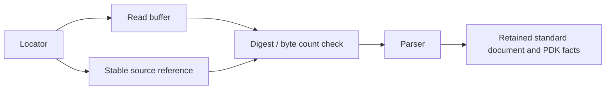

# Standard Inspection

## Purpose and Scope

Own `LocalPDKStandardViewInspector` and `PDKStandardViewIR`.
Parent: [PDKStandardViews](../DESIGN.md). No children.

## Responsibilities and Boundaries

Bind parsed facts to the exact bytes read. Preserve LEF physical declarations
using the standard-owned schema. Report parser or integrity failures without
publishing a successful inspection.

## Related Designs

| Design | Relationship | Contract Used | Summary | Cautions |
|---|---|---|---|---|
| [Module](../DESIGN.md) | Parent | Inspection results | Public host boundary | Engine support and process qualification remain independent |
| [LEF](../../../../swift-mask-data/Sources/LEF/DESIGN.md) | Depends on | Reader and LEFDocument | Preserve cell/pin/via/site/rule values | Unsupported or unretained grammar must remain explicit |
| [CircuiteFoundation](../../../../CircuiteFoundation/DESIGN.md) | Depends on | ArtifactReference, digest, integrity | Canonical content identity | Compare the parsed buffer to the retained reference |

## Architecture

## Contracts and Invariants

The parsed buffer's digest and size match the retained reference. A LEF view
retains both axes, physical cell/pin/via/site declarations and supported rules;
inventory fields derive from the same document. Non-LEF formats have no LEF
document. No extra PDK physical schema redefines standard field semantics.

## Failure, Concurrency, and Constraints

Execution state is local to the call. The injected clock is Sendable and owns its
own synchronization. Invalid input, changed content and parser failure emit
structured failure results. No successful partial document is published when the
codec reports an unsupported statement.
The current codec intentionally rejects unmodeled global controls, layer
properties and masked polygons. These failures describe grammar coverage and do
not permit a consumer to substitute weaker physical rules.

## Verification and Change Impact

Tests exercise local and manifest inspection, JSON round trips, asymmetric
physical grid values and typed parser failure. Removing an incomplete marker
requires successful retained semantics and explicit failure-path evidence;
retention does not establish downstream native physical closure.
