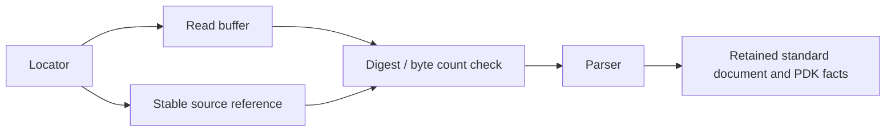

# Standard Inspection

## Purpose and Scope

Own `LocalPDKStandardViewInspector` and `PDKStandardViewIR`.
Parent: [PDKStandardViews](../DESIGN.md). No children.

## Responsibilities and Boundaries

Bind parsed facts to the exact bytes read. Preserve LEF physical declarations
using the standard-owned schema. Report parser or integrity failures without
publishing a successful inspection.

## Related Designs

| Design | Relationship | Contract Used | Summary | Cautions |
|---|---|---|---|---|
| [Module](../DESIGN.md) | Parent | Inspection results | Public host boundary | Engine support and process qualification remain independent |
| [LEF](../../../../swift-mask-data/Sources/LEF/DESIGN.md) | Depends on | Reader and LEFDocument | Preserve cell/pin/via/site/rule values | Unsupported or unretained grammar must remain explicit |
| [CircuiteFoundation](../../../../CircuiteFoundation/DESIGN.md) | Depends on | ArtifactReference, digest, integrity | Canonical content identity | Compare the parsed buffer to the retained reference |

## Architecture

## Contracts and Invariants

The parsed buffer's digest and size match the retained reference. A LEF view
retains both axes, physical cell/pin/via/site declarations and supported rules;
inventory fields derive from the same document. Non-LEF formats have no LEF
document. No extra PDK physical schema redefines standard field semantics.

For LEF, `layerNames` is the sorted unique inventory of explicit layer names
observed in that document: top-level LAYER declarations, macro PIN PORT and OBS
layer references, and local VIA layer records. A reference does not declare a
layer rule; `lefDocument.layers` retains the separate source declarations without
augmentation. An external VIA name supplies no layer inventory. The inspector
does not resolve external masters or infer layer names from via naming conventions.

GDSII and OASIS readers use the same fallible Mask IR projection. Its physical
layer inventory includes explicit boundary, path and text layers. A typed
`IRVia` names a master and route layer but does not supply its physical cut and
enclosure layers. This inspector has no master-resolution input contract; it
therefore refuses such a placement with `PDKMaskProjectionError.unboundViaMaster`
instead of treating the route layer as a complete physical inventory. The public
execution boundary returns a blocked result with
`pdk.standard-view.via-master-unbound` and no inspection. This does not add a
DEF inspection format or a geometry expansion schema.

## Failure, Concurrency, and Constraints

Execution state is local to the call. The injected clock is Sendable and owns its
own synchronization. Invalid input, changed content and parser failure emit
structured failure results. No successful partial document is published when the
codec reports an unsupported statement.
Unbound via projection is an insufficient-semantics blocker; ordinary malformed
codec input remains a parse failure. Source artifact identity is retained when
the projection cannot produce an inspection.
The current codec intentionally rejects unmodeled global controls, layer
properties and masked polygons. These failures describe grammar coverage and do
not permit a consumer to substitute weaker physical rules.

## Verification and Change Impact

Tests exercise local and manifest inspection, JSON round trips, asymmetric
physical grid values and typed parser failure. Removing an incomplete marker
requires successful retained semantics and explicit failure-path evidence;
retention does not establish downstream native physical closure.
[PDKReferencedLEFLayerTests](../../../Tests/PDKKitTests/PDKReferencedLEFLayerTests.swift)
owns actual macro-only PORT mapping, complete observed layer inventory, retained
document/content identity and absent/external-via-only layer refusal through the
public inspection and manifest binding APIs.
Actual GDSII/OASIS fixture execution retains exact source identity and round-trips
the inspection result. The production projection's internal test boundary also
admits real `IRVia` values and verifies typed refusal, preventing an incomplete
route-layer inventory from appearing successful. Mask schema changes require
this shared projection and its public execution callers to be rechecked.
